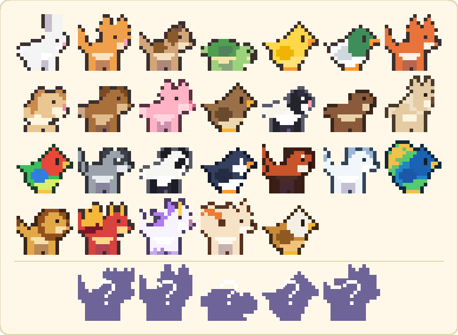

# Desktop Tamagotchi

[한국어](README.md) · **English**

Raise a **pixel pet** that wanders across your desktop. Feed it, play with it, wash it, take it for walks, collect new friends with gacha, and dress it up with hats and accessories.
For developers there is a bonus: the pet looks at the `localhost` pages you are building and tells you in a speech bubble about **basics you may have missed** (image alt text, button names, text contrast, keyboard access …).



> 🐣 **v0.12.3** · Windows 10/11 · macOS (preview) · Free (MIT) · [Get the latest version](https://github.com/junhooo111/desktop-tamagotchi/releases/latest)

## Put your pet on your GitHub profile (1 minute)

Log in with your GitHub account and **your pet moves on your GitHub profile.** It uses GitHub login only (no password), and on any PC with the same account you can keep raising the same collection.

1. Install the app, right-click the pet → **`☁ Log in with GitHub…`** and approve in the browser (first time only).
2. Right-click → **`☁ your name` → `Copy card URL for GitHub profile`**. A line like this is copied:

   ```markdown
   
   ```
3. On GitHub, paste it into the `README.md` of **your profile repository** (`yourname/yourname`, a public repo with a README) and save. If this is your first time, see [Creating your profile README](https://docs.github.com/en/account-and-profile/setting-up-and-managing-your-github-profile/customizing-your-profile/managing-your-profile-readme).

- The card is **drawn by the server**, so it updates with your latest level and pet even when the app is closed (GitHub caches images for a few minutes).
- The card shows your GitHub name, your pet (with its color, accessory, name, and appearance), and your streak, codex, achievement, fixed-problem, quiz, and tip counts. No email and no currency. The streak is based on the last day the app uploaded its values, so it shows 0 if you do not open the app for more than two days. To hide it, turn off **"Show my name in rankings"** under `🏆 Rankings…` (the card disappears too).

## At a glance

| | |
|---|---|
| What it is | A pet that wanders the screen, hangs from your mouse, and climbs walls. It starts as an egg and grows into a baby, then an adult |
| Collecting | Collect 20 animals through gacha (6 hidden animals keep even their names secret until you pull them) |
| Dressing up | 18 accessories and 3 colors, earned through achievements or gacha |
| Platforms | **Windows 10/11 (64-bit)**, macOS (preview) |
| Requirements | Just install it (no admin rights, no Node.js) |
| Internet | Not needed unless you log in (only used to check for updates and news). Gacha and rankings need login |
| Account (optional) | Log in with GitHub to keep the same collection on any PC, see rankings, and use the profile card. Everything still works without logging in |
| Language | Korean and English. Pick in Settings (default follows your PC) |

## Install

### Windows

1. Download `Desktop-Tamagotchi-Setup-<version>.exe` from the **[Releases page](https://github.com/junhooo111/desktop-tamagotchi/releases/latest)**. (`.blockmap` and `latest.yml` are for auto-update; you do not need them.)
2. Double-click it. It installs without a setup window and the pet appears when it finishes. No admin rights are needed, and shortcuts are added to the Start menu and desktop.
3. **If "Windows protected your PC" appears**: this personal project has no code-signing certificate. Click **`More info`** → **`Run anyway`**.

### macOS (preview)

1. Download the file for your Mac: Apple Silicon (M1 and later) = `...-mac-arm64.zip`, Intel = `...-mac-x64.zip`.
2. Unzip and move `Desktop Tamagotchi.app` to **Applications**.
3. If it is blocked the first time, run this in Terminal and then **right-click → Open**:

```
xattr -cr "/Applications/Desktop Tamagotchi.app"
```

It is unsigned, so this step is needed. New versions are downloaded by the app and applied when you quit. It has not been tested enough on Macs, so please tell us if anything looks wrong.

### Uninstall and data

- Uninstall: Windows `Settings ▸ Apps ▸ Installed apps` → remove `Desktop Tamagotchi`.
- Pet data lives in `%APPDATA%\desktop-tamagotchi` (on Mac `~/Library/Application Support/desktop-tamagotchi`) and **survives uninstalling and reinstalling.** To start over, quit the app and delete that folder.
- To build the installer yourself, see the [developer docs](docs/development.md).

## Getting started

1. After installing, an **egg** appears. (An icon also appears in the tray at the bottom right; press `^` if you cannot see it.)
2. **Click (pet)** the egg and it warms up, **hatching after about 10 clicks**. Which animal appears is random only the first time.
3. A baby wanders the screen. Click to pet it, and **right-click** to feed it and play.
4. In `🎟 Gacha & Collection…` use the **3 starter tickets** for your first pull.
5. To have the pet appear every time you turn on your PC, right-click → **`Launch at login`**.

### Controls

| What you want | How |
|---|---|
| Pet it | **Click** the pet (it works once per 30 seconds; for an egg once per 5 seconds) |
| Open the menu | **Right-click** the pet or the tray icon |
| Move it | **Drag** the pet and drop it; it falls to the floor |
| See its status | Right-click → `Show status` |
| Quit | Right-click → `Quit` |

Clicks on the transparent part around the pet **pass straight through to the window below**, so it does not get in your way.

## Caring for your pet

| Action | Result | Gain |
|---|---|---|
| Pet (click) | Hearts float up | Mood +3, XP +1 |
| Feed | It eats in front of you; it will not eat when full (90+) | Fullness +30, XP +5 |
| Play | It hops or rolls; it will not play when too hungry (under 15) | Mood +25, XP +8 |
| **Wash** | Soap bubbles pile up | Cleanliness full, mood +5, XP +4 |
| **Take a walk** | It **follows your mouse** for 1 to 2 minutes, then sits and rests for 2 minutes | Mood +15, XP +6 when done |
| **Let it play alone** | It only plays near where you right-clicked (about 220px). Release with `Let it roam freely` | Resets on restart |

## Growth and levels

| Stage | Condition |
|---|---|
| 🥚 Egg | Under 20 XP. It bounces; you can only pet it |
| 🐣 Baby | 20 XP up to level 5 |
| 🐾 Adult | Level 5 or higher (160 XP) |
| ✨ Legend | **Hidden animals only** evolve once more at level 10, with a golden shimmer |

An animal from gacha comes out as a **baby**, not an egg. Rank colors change every 10 levels (Newbie, Skilled, Veteran, Master, Grandmaster, Mythic).

## Collecting animals: gacha and collection

Right-click → **`🎟 Gacha & Collection…`**. Animals come **only from gacha**. Pulled animals gather in your collection and you **take out one** to raise; the others have their time stopped.

- **14 common animals** have equal odds (about 6.7% each) and **6 hidden animals** are very rare (1% each). Hidden animals show as `???` until you pull them.
- **Pity**: if no hidden animal appears, the 40th pull always gives one.
- **A duplicate** raises that animal's count and gives +30 XP.
- An animal pull costs **3 tickets**; a cosmetic pull costs **2**.

### How to get tickets

| Way | Amount |
|---|---|
| Starter gift | 3 on first launch |
| Check-in | 1 on the first launch each day |
| Leave it running | 1 per 6 hours of running (up to 1 a day) |
| Care | 1 per 25 petting, feeding, playing, washing, or walks |
| Level up | 2 at levels 5, 10, 15… and 1 at levels 8, 13, 18… (per animal) |
| Update gift | 2 the first time you launch a new version |
| Gift box | A gift box comes 2 to 3 times a day, with a 15% chance of 1 ticket |

### Gift box

A few times a day the pet stops what it is doing, **runs to the center of the monitor you are looking at**, and waits holding a gift box. Click the box to open it: it may hold a ticket, XP, or poop (no prize). If you do not click it, the box disappears after 5 minutes.

### Auction house and game money (logged-in players)

When logged in you can buy and sell pets with other players. Right-click → `🏪 Auction house…`

- **Game money** is separate from tickets. It is used only in the auction house and cannot be cashed out.
- **How to earn it** (amounts and daily caps are set by the server):
  - Care: 5 per 10 care actions (up to 100 a day)
  - Achievements: 30 each (up to 300 a day)
  - **GitHub contributions**: 2 each (up to 40 a day)
  - **Learning**: card confirmation 10, quiz bonus 5, fixing a problem 20, reading an FE tip 2 (up to 150 a day)
- **Buying**: pets for sale are listed cheapest first; buying makes it yours immediately.
- **Selling**: list a pet from the `Sell my pets` tab at a price from 1 to 1,000,000. When it sells you receive the **full price with no fee**. You can remove a listing with `Remove`. You cannot sell your last pet.
- GitHub contributions are checked right after login and every hour (`☁ your name` → `Check GitHub contributions now`). It uses the GitHub contribution calendar, so pull requests and issues count too.

## Customize

Right-click → `Customize…`. Achievements unlock colors and accessories (the codex unlocks the crown, fixing many problems unlocks wings, a streak unlocks the flower and halo). You can also pull cosmetics with tickets. You can name your pet there, and **names you give are never translated**.

## Inspecting your pages (for developers)

The pet looks at `localhost` pages you have open every 10 seconds and finds **50 kinds of basics** that are easy to miss: image alt text, button and link names, input labels, document language, heading order, tap target size, text contrast, horizontal overflow, duplicate ids, blocked zoom, table headers, search description, keyboard focus, color-only links, captions, autoplay sound, image size and lazy loading, render-blocking scripts, mixed content, and more.

The rules are grouped by **who they are for**: screen reader users, keyboard and hand users, vision (low vision, color blindness), hearing, cognition and time, plus search (SEO), responsive, performance, security, and code quality. In `Settings` → `Rules to check` you can turn whole groups on or off (for example, check only for keyboard users).

When it finds something the pet runs next to it and shows a speech bubble: what is wrong, where, and how to fix it. Click the pet to open a **learning card** with why it matters, a fix, a code example, and a short quiz. Confirming the card gives XP (and game money when logged in). It also tells you one of **69 FE tips** every 20 minutes (performance, CSS, JS/TS, React, security, accessibility, network, SEO).

It only looks at `localhost`, `127.0.0.1`, and `*.localhost` pages. Right-click → `Inspection tools` has `Try inspection (open demo page)` and a Chrome extension for your everyday Chrome.

## Right-click menu at a glance

| Menu | What it does |
|---|---|
| Show status | Name, level rank, and bars for XP, fullness, mood, cleanliness |
| Inspection results… | Problems found per page, with fixes and an ignore list |
| Codex & records… | Streak, codex of problem types, achievements |
| 🏪 Auction house… | Buy and sell pets (logged-in players) |
| 🏆 Rankings… | Rankings for codex, hidden, pets, level, pulls, cosmetics (logged-in players) |
| 🎟 Gacha & Collection… | Pull and take out animals |
| 📢 News | Re-read recent news |
| ☁ Log in with GitHub… / ☁ your name | Log in, sync, copy the profile card URL, log out |
| Settings… | Size, language, intervals, rules, updates |
| Feed / Play / Wash / Take a walk | Care |
| Customize… | Name, color, accessory, appearance, profile card pet |
| Quit | Quit the app |

## Settings and updates

Right-click → **`Settings…`**. Changes apply and save immediately.

| Item | Choices | Description |
|---|---|---|
| Pet size | 1x (default) / 2x / 3x | 1x is about the size of a mouse cursor |
| Page inspection | On / Off | Off means the pet only plays |
| Inspection interval | 5, 10 (default), 30, 60 s | How often open local pages are checked |
| **Language** | Auto (default) / 한국어 / English | Auto follows your PC: Korean if your language is Korean or your region is Korea, otherwise English. Menus, bubbles, windows, inspection cards, and FE tips change |
| FE tip notifications | Off / 10 / 20 (default) / 60 min | How often a tip bubble appears when the pet is idle |
| Rules to check | Per rule or per group | Rules turned off are not reported |
| Auto update | On (default) / Off | Tells you and downloads new versions |
| News | On (default) / Off | The pet tells you about new news |

New versions are downloaded in the background and installed when you quit the pet (or right-click → `Install and restart`).

## Privacy and safety

- **Without logging in, nothing leaves your PC.** There are no analytics or ads, and inspected content is never sent out. (It only reads public files in this repository to check for new versions and news.)
- **If you log in (optional)**, your GitHub name and avatar URL (for display) and your progress (animals, XP, tickets, cosmetics, codex file) are stored on your account on the server (Supabase). Your email is not stored. No password is used (GitHub login), and the login info is encrypted in this PC's secure storage. Rankings, the profile card, and the auction house show only your GitHub name, pet and its look, and scores, and you can turn them off at any time. Inspected page content is never sent to the server, even when logged in.
- Page inspection looks only at `localhost`, `127.0.0.1`, and `*.localhost` tabs.
- The Chrome extension has minimal permissions (no cookies or history). It only sends a "problem list" to the pet app on this PC, never page content or input values.

## FAQ

**The pet does not appear.** Check the tray icon (press `^` to expand). If it is not running, launch `Desktop Tamagotchi` from the Start menu.

**Clicks do not work.** Click the pet itself; the transparent area around it passes clicks through on purpose.

**The installer is blocked.** Click `More info` → `Run anyway` (see Install above).

**I want to start over.** Quit the app and delete the `%APPDATA%\desktop-tamagotchi` folder.

## More

- [Inspection guide](docs/inspection-guide.md) (in Korean)
- [Developer docs](docs/development.md) (in Korean)
- [Releases](https://github.com/junhooo111/desktop-tamagotchi/releases)
