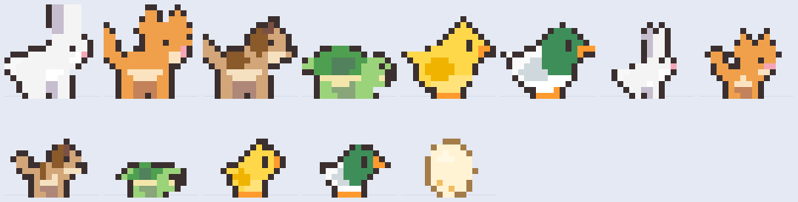

# desktop-tamagotchi

내 PC 바탕화면에 띄워 두고 키우는 **다마고치형 데스크톱 펫**입니다.
화면 위를 돌아다니며 놀고, 내가 개발 중인 `localhost` 페이지에서 **놓친 기본기(이미지 alt, 버튼 이름, 명암 대비 등)를 찾아 말풍선으로 알려 주고**, 고치는 방법과 퀴즈로 함께 배우며 자랍니다.
AI로 화면을 만들다 보면 놓치기 쉬운 FE 기본기를 펫이 짚어 주는 것이 목표입니다. ([컨셉](docs/concept.md))



*왼쪽부터 토끼·고양이·강아지·거북이·병아리·오리(성체), 이어서 새끼들과 알. 용·청룡·백호·현무·주작·기린은 뽑기에서 아주 드물게 나오는 히든 동물입니다*

> 상태: 🐣 **v0.7.0** ([최신 릴리스 받기](https://github.com/junhooo111/desktop-tamagotchi/releases/latest)) — Windows 에서 설치해서 바로 쓰는 데스크톱 앱입니다. 설정·자동 업데이트·성장 기록·꾸미기·크롬 확장까지 갖췄고, 계정·웹사이트·거래는 아직 계획 단계입니다(맨 아래 "앞으로의 계획").

## 목차

1. [한눈에 보기](#한눈에-보기)
2. [내려받아 설치하기](#내려받아-설치하기)
3. [처음 시작하기](#처음-시작하기)
4. [설정](#설정)과 [펫 키우기](#펫-키우기)
5. [펫이 하는 행동](#펫이-하는-행동)
6. [놓친 부분 찾기](#놓친-부분-찾기-내-페이지-검사하기)
7. [FE 지식 알림](#fe-지식-알림)
8. [개인정보와 안전](#개인정보와-안전)
9. [문제 해결](#문제-해결)
10. [자주 묻는 질문](#자주-묻는-질문)
11. [개발자를 위한 정보](#개발자를-위한-정보)

## 한눈에 보기

| | |
|---|---|
| 하는 일 | 화면을 돌아다니는 픽셀 펫을 키우고, 내 `localhost` 페이지의 접근성·반응형 기본기 문제를 찾아 알려 줍니다 |
| 지원 환경 | **Windows 10/11 (64비트)**. macOS·Linux 는 아직 설치 파일이 없습니다 |
| 필요한 것 | 설치만 하면 됩니다(관리자 권한 불필요, Node.js 불필요). 페이지 검사에는 크롬(또는 엣지 같은 크로미움 계열 브라우저)이 필요합니다 |
| 인터넷 | 필요 없습니다. 지식 알림·퀴즈까지 전부 앱 안에 들어 있습니다 |
| 내 정보 | 펫 상태는 내 PC 안에만 저장됩니다. 계정·서버·통계 전송이 없습니다 |

## 내려받아 설치하기

### 1. 설치 파일 내려받기

1. 이 저장소의 **[Releases 페이지](https://github.com/junhooo111/desktop-tamagotchi/releases)** 로 갑니다.
2. 가장 위(최신) 릴리스의 **Assets** 에서 `Desktop-Tamagotchi-Setup-<버전>.exe` 를 내려받습니다. (`.blockmap`, `latest.yml` 은 자동 업데이트용이라 직접 받을 필요가 없습니다.)

> 릴리스에 파일이 없다면 아직 올리지 않은 것입니다. 아래 [직접 만들어서 설치하기](#직접-만들어서-설치하기)로 설치 파일을 만들 수 있습니다.

### 2. 설치하기

내려받은 `.exe` 를 더블클릭합니다.

- 설치 창 없이 **바로 설치**되고, 끝나면 펫이 바로 나타납니다.
- **관리자 권한이 필요 없습니다.** 내 Windows 계정에만 설치됩니다.
- 시작 메뉴와 바탕화면에 `Desktop Tamagotchi` 바로가기가 생깁니다.

### 3. "Windows의 PC 보호" 경고가 뜰 때

이 설치 파일은 **코드 서명을 하지 않았기 때문에** 처음 실행할 때 Windows SmartScreen 이 경고를 띄울 수 있습니다(개인 프로젝트라 서명 인증서가 없습니다).

1. 파란 경고 창에서 **`추가 정보`** 를 누릅니다.
2. 아래에 나타나는 **`실행`** 버튼을 누릅니다.

출처가 이 저장소의 Releases 인지 확인하고, 불안하다면 소스를 직접 읽거나 직접 빌드해서 쓰세요(코드는 모두 공개되어 있습니다).
일부 백신이 서명 없는 앱을 차단하면 해당 백신의 예외 목록에 설치 폴더(내 계정 전용 위치인 `%LOCALAPPDATA%\Programs` 아래에 생깁니다)를 추가해야 할 수 있습니다.

### 4. 지우기와 데이터 위치

- 지우기: Windows **`설정 ▸ 앱 ▸ 설치된 앱`** 에서 `Desktop Tamagotchi` 를 제거합니다.
- 펫 상태·진행도는 `%APPDATA%\desktop-tamagotchi` 폴더에 저장됩니다. 앱을 지우거나 다시 설치해도 **남아 있어서 그대로 이어서 키울 수 있습니다.**
- 처음부터 다시 키우고 싶다면 앱을 종료한 뒤 그 폴더를 지우세요.

### 직접 만들어서 설치하기

[Node.js](https://nodejs.org/) (LTS)가 필요합니다. 처음 한 번만 하면 됩니다.

```powershell
git clone https://github.com/junhooo111/desktop-tamagotchi.git
cd desktop-tamagotchi
npm install
npm run dist
```

끝나면 `release\Desktop-Tamagotchi-Setup-<버전>.exe` 가 생깁니다. 이후는 위 "설치하기"와 같습니다.
설치하지 않고 실행만 해 보려면 `npm start` 를 쓰세요([개발 환경에서 실행](#개발-환경에서-실행)).

## 처음 시작하기

1. 설치가 끝나면 화면에 **알**이 나타납니다. (작업 표시줄 오른쪽 아래 트레이에도 아이콘이 생깁니다. 안 보이면 `^` 를 눌러 숨겨진 아이콘을 확인하세요.)
2. 알을 **클릭(쓰다듬기)** 하면 따뜻해지다가 **약 10번이면 부화**합니다. 어떤 동물이 나올지는 처음 실행할 때 무작위로 정해집니다.
3. 부화하면 새끼가 화면을 돌아다니기 시작합니다. 클릭해서 쓰다듬고, 우클릭해서 밥을 주고 놀아 주세요.
4. 내 개발 환경에서 `localhost` 페이지를 열어 두면 펫이 [문제를 찾아 줍니다](#놓친-부분-찾기-내-페이지-검사하기). 먼저 체험해 보고 싶다면 우클릭 → `검사 도구` → `검사 체험` 을 눌러 보세요.
5. PC 를 켤 때마다 펫이 나오게 하려면 펫을 우클릭 → **`로그인할 때 자동 실행`** 을 켭니다.

### 조작법

| 하고 싶은 것 | 방법 |
|---|---|
| 쓰다듬기 | 펫을 **클릭** (30초에 한 번 효과가 있습니다. 알은 5초에 한 번) |
| 메뉴 열기 | 펫이나 트레이 아이콘을 **우클릭** |
| 옮기기 | 펫을 **누른 채 끌어서** 놓기 (놓으면 바닥으로 떨어집니다. 그냥 클릭만 해서는 들어 올려지지 않습니다) |
| 밥 주기 / 놀아주기 | 우클릭 메뉴의 `밥 주기` / `놀아주기` |
| 상태 보기 | 우클릭 메뉴의 `상태 보기` (종·단계·레벨·배고픔·기분이 말풍선으로 나옵니다) |
| 종료 | 우클릭 메뉴의 `종료` (창을 닫는 버튼은 없습니다) |

펫이 없는 투명한 부분은 클릭이 **아래 창으로 그대로 통과**하므로 평소 작업을 방해하지 않습니다.

### 우클릭 메뉴 한눈에 보기

| 메뉴 | 설명 |
|---|---|
| 상태 보기 | 펫 상태를 말풍선으로 보여 줍니다 |
| 검사 결과… | 지금 열린 페이지에서 찾은 문제를 한눈에 보고, 문제를 무시하거나 되돌립니다([검사 결과](#검사-결과-창과-무시)) |
| 도감·기록… | 연속 사용 기록, 배운 문제 종류(도감), 업적을 보여 줍니다([도감·연속 사용·업적](#도감연속-사용업적)) |
| 프로필 카드 내보내기… | 내 펫이 계단·집이 있는 작은 마을을 돌아다니고 아래에 레벨·도감·업적 기록이 붙은 움직이는 SVG 를 저장합니다([프로필에 내 펫 걸기](#프로필에-내-펫-걸기)) |
| 설정… | 펫 크기·검사 주기·지식 알림 주기·자동 업데이트를 바꿉니다([설정](#설정)) |
| 새 버전 … 설치하고 다시 시작 | 새 버전을 받아 둔 뒤에만 나타납니다 |
| (검사 상태 줄) | 검사 연결 상태. 예) `검사: 확장 연결됨 · 로컬 페이지 1개` |
| 지금 검사하기 | 10초 주기를 기다리지 않고 바로 검사합니다 |
| 검사 도구 ▸ 검사용 브라우저 열기 | 검사 전용 크롬 창을 엽니다(로그인 정보 없는 별도 프로필) |
| 검사 도구 ▸ 검사 체험 | 일부러 문제를 넣어 둔 시험 페이지를 엽니다 |
| 검사 도구 ▸ 크롬 확장 폴더 열기 | 평소 쓰는 크롬에서 검사하려면 필요한 확장 폴더를 엽니다 |
| 오늘의 FE 지식 | 20분을 기다리지 않고 FE 지식 말풍선을 바로 띄웁니다 |
| 쓰다듬기(클릭) / 밥 주기 / 놀아주기 / 씻기기 | 펫 돌보기. 하나가 끝나기 전에는 다음 돌봄을 받지 않습니다([돌보기와 산책](#돌보기와-산책)) |
| 산책하기 | 1~2분 동안 마우스를 따라다니다 지칩니다. 가는 길에 응가를 합니다 |
| 혼자 놀게 두기 (여기서만) | 우클릭한 자리 근처에서만 돌아다니게 합니다. `자유롭게 돌아다니게 하기`로 풉니다 |
| 🎟 뽑기·컬렉션… | 뽑기권으로 새 동물·꾸미기를 뽑고 가진 동물 중 한 마리를 꺼냅니다([뽑기와 컬렉션](#뽑기와-컬렉션)) |
| 동작 보기 (테스트용) | 잠자기·달리기·벽 타기·혼자 놀기를 바로 시켜 봅니다 |
| 꾸미기… | 이름·색·장식을 고르고, 프로필 카드에 보여 줄 동물을 정합니다([꾸미기와 보상](#꾸미기와-보상)) |
| 로그인할 때 자동 실행 | PC 를 켤 때 펫을 자동으로 띄웁니다(설치본에서만) |
| 종료 | 앱을 끝냅니다 |

## 설정

펫 우클릭 → **`설정…`** 에서 바꿀 수 있고, 바꾸면 **바로 적용·저장**됩니다(저장 위치: `%APPDATA%\desktop-tamagotchi\settings.json`).

| 항목 | 선택지 | 설명 |
|---|---|---|
| 펫 크기 | 1배(기본) / 2배 / 3배 | 1배가 마우스 커서 정도입니다. 도트가 뭉개지지 않게 정수 배율만 지원합니다 |
| 문제 검사 | 켜기 / 끄기 | 끄면 펫은 놀기만 하고 페이지를 검사하지 않습니다 |
| 검사 주기 | 5초 / 10초(기본) / 30초 / 60초 | 열려 있는 로컬 페이지를 얼마나 자주 살펴볼지 |
| FE 지식 알림 | 끄기 / 10분 / 20분(기본) / 60분 | 가만히 있을 때 지식 말풍선을 띄우는 간격. 우클릭 메뉴의 `오늘의 FE 지식`은 끄더라도 쓸 수 있습니다 |
| 검사할 규칙 | 규칙별 켜기(기본) / 끄기 | 분류(접근성·검색·반응형·성능)별로 묶여 있습니다. 끄면 그 종류의 문제는 찾아도 알리지 않습니다. `모두 켜기`로 되돌립니다 |
| 자동 업데이트 | 켜기(기본) / 끄기 | 아래 [업데이트](#업데이트) 참고 |

### 업데이트

- **공지**: 설치한 앱이 시작 1분 뒤와 1시간마다 이 저장소의 `news.json`(원격 파일 읽기만, 내 정보는 보내지 않음)을 읽어, 새 공지를 말풍선과 Windows 알림으로 알립니다. 한 번 본 공지는 다시 알리지 않고, 처음 켠 사용자에게는 가장 최신 하나만 알립니다. 우클릭 메뉴의 `📢 공지`에서 최근 5개를 다시 볼 수 있고, 설정에서 끌 수 있습니다. 메인테이너는 `news.json` 의 `items` 에 `{id, date, title, body, url}` 를 추가해 push 하면 됩니다(제목 40자·본문 200자, 링크는 이 저장소 주소만).
- 우클릭 메뉴의 `업데이트 확인 (현재 vX.Y.Z)`로 새 버전을 직접 확인할 수 있습니다.
- **설치한 앱**은 시작 30초 뒤와 30분마다 이 저장소의 GitHub Releases 에서 새 버전을 확인합니다. 새 버전이 있으면 받아 두고, 설치하기 전까지 10분마다 말풍선으로 다시 알립니다(세 번에 한 번은 Windows 알림도 띄우며, 알림을 누르면 바로 설치합니다). 우클릭 메뉴 맨 위에도 `🆕 새 버전 … 설치하고 다시 시작`이 올라옵니다.
- 받아 둔 새 버전은 **앱을 종료할 때 자동으로 설치**됩니다. 바로 설치하려면 우클릭 메뉴의 `새 버전 … 설치하고 다시 시작`을 누르세요.
- `설정…` → `업데이트 확인`으로 직접 확인할 수도 있습니다(자동 업데이트를 꺼 둬도 직접 확인한 새 버전은 받습니다).
- 개발 환경(`npm start`)에서는 업데이트를 확인하지 않습니다.
- 업데이트 기능은 **0.4.0 부터** 들어 있어서, 0.3.0 을 쓰고 있다면 한 번은 새 설치 파일을 직접 받아 설치해야 합니다.

## 펫 키우기

### 성장 단계

| 단계 | 조건 | 모습 |
|---|---|---|
| 🥚 알 | 경험치 20 미만 | 통통 튑니다. 쓰다듬기만 할 수 있습니다 |
| 🐣 새끼 | 경험치 20 이상, 레벨 5 미만 | 머리가 큰 아기 비율. 걷고, 졸고, 놀 수 있습니다 |
| 🐾 성체 | **레벨 5 이상 (경험치 160)** | 마우스 커서만 한 크기(약 32px)의 성체 |

레벨은 경험치로 정해집니다: 레벨 2 = 10, 레벨 3 = 40, 레벨 4 = 90, 레벨 5 = 160 경험치. (경험치가 늘수록 다음 레벨까지 더 많이 필요합니다.)

### 경험치를 얻는 방법

| 행동 | 경험치 | 비고 |
|---|---|---|
| 알 쓰다듬기 | +2 | 5초에 한 번 |
| 쓰다듬기 | +1 | 30초에 한 번. 기분 +3 |
| 밥 주기 | +5 | 배고픔 +30. 이미 배부르면(90 이상) 먹지 않습니다 |
| 놀아주기 | +8 | 기분 +25, 배고픔 -5. 너무 배고프면(15 미만) 놀지 않습니다 |
| **문제 확인 (배움 카드)** | **+10** | 퀴즈를 맞히면 **+5** 보너스 |
| **고친 문제** | **+20** | 확인했던 문제를 고쳐서 사라지면 |
| FE 지식 읽기 | +2 | 처음 읽는 지식만(복습은 0) |

### 배고픔과 기분

- **배고픔**은 6분에 1씩, **기분**은 10분에 1씩 줄어듭니다. **앱을 꺼 둔 시간만큼도 줄어 있습니다**(다마고치처럼 오래 방치하면 배고파집니다).
- 배고픔이 30 미만이면 `배고픔`, 기분이 30 미만이면 `시무룩`, 둘 다 70 이상이면 `행복` 상태입니다.
- 걱정하지 마세요. 펫이 죽거나 사라지지는 않습니다. 다시 돌봐 주면 회복됩니다.

### 펫 종류

일반 동물 **9종**(토끼, 고양이, 강아지, 거북이, 병아리, 오리, 여우, 햄스터, 펭귄)과 **히든 동물 6종**(용, 청룡, 백호, 현무, 주작, 기린)이 있습니다. 동물은 업적이 아니라 **뽑기**로 얻습니다([뽑기와 컬렉션](#뽑기와-컬렉션)). 종마다 걸음걸이가 다릅니다.
고양이·강아지·여우·햄스터·거북이는 대각선 발을 번갈아 내딛는 걸음, 토끼는 깡충깡충, 병아리·오리·펭귄은 뒤뚱뒤뚱 걷습니다.
처음 받는 알은 기본 6종 중 무작위이고, 우클릭 메뉴의 `꾸미기…` 에서 열린 친구로 바꿀 수 있습니다.

### 도감·연속 사용·업적

우클릭 메뉴의 **`도감·기록…`** 에서 볼 수 있습니다. 저장 위치는 `%APPDATA%\desktop-tamagotchi\growth.json` 입니다.

- **연속 사용**: 쓰다듬기·밥 주기·놀아주기·배움 카드 확인·문제 고치기·지식 읽기 중 **하나라도 한 날**이 하루로 셉니다(앱만 켜 둔 날은 세지 않습니다). 오늘 아직 안 했어도 어제까지 이어졌다면 스트릭은 살아 있고, 하루를 통째로 빠지면 현재 기록이 0 으로 돌아갑니다(최고 기록은 남습니다). 날짜는 내 PC 시계 기준입니다.
- **도감**: 배움 카드를 확인한 문제 종류가 채워집니다. 아직 못 만난 종류는 `???` 로 숨어 있고, 확인하면 `배움`, 그 종류의 문제를 실제로 고치면 `고침` 으로 한 단계 올라갑니다. 문제 종류는 19종입니다.
- **업적**: 조건을 채우면 펫이 알려 주고 **경험치**를 줍니다(업적마다 한 번만).

| 업적 | 조건 | 경험치 |
|---|---|---|
| 첫 배움 / 열심히 배우는 중 / FE 꿈나무 | 배움 카드 확인 1 / 10 / 50번 | +5 / +15 / +40 |
| 퀴즈 척척 / 퀴즈 박사 | 확인 퀴즈 정답 5 / 25번 | +10 / +30 |
| 첫 수정 / 문제 해결사 / FE 장인 | 찾은 문제 고치기 1 / 10 / 30개 | +10 / +30 / +80 |
| 다섯 / 열 가지 기본기 | 서로 다른 문제 종류 5 / 10종 배우기 | +20 / +40 |
| 도감 완성 | 모든 종류(19종)를 한 번씩 배우기 | +100 |
| 지식 수집가 / 지식 박사 | FE 지식 10개 / 전부 읽기 | +10 / +50 |
| 사흘 / 일주일 / 한 달 연속 | 3 / 7 / 30일 연속 사용 | +10 / +30 / +100 |
| 다정한 친구 | 쓰다듬기·밥·놀이 합쳐 50번 | +10 |

### 돌보기와 산책

| 메뉴 | 하는 일 |
|---|---|
| 밥 주기 / 놀아주기 / 쓰다듬기(클릭) | 배고픔·기분이 오르고 경험치를 받습니다. **하나의 행동이 끝나기 전에는 다음 돌봄을 받지 않습니다**(먹는 중·노는 중·씻는 중·기절한 중) |
| 씻기기 | 청결을 가득 채웁니다. 청결은 12분에 1씩 줄고, 30 아래면 더러워서 냄새 줄이 피어오릅니다 |
| 산책하기 | 1~2분 동안 마우스를 따라다니다가 지쳐서 앉고, 2분 쉽니다(쉬는 동안은 따라오지 않음). 가는 길에 **응가**를 하고 그것은 25초 뒤 사라집니다. 돌아오면 기분이 오르고 조금 지저분해집니다 |
| 혼자 놀게 두기 (여기서만) | 우클릭한 자리 둘레 220px 안에서만 돌아다닙니다. `자유롭게 돌아다니게 하기`로 풉니다(앱을 다시 켜면 풀립니다) |

- **높은 데서 떨어지면 기절합니다.** 300px 이상 위에서(마우스에 매달렸다 떨어지거나 들었다 놓을 때) 바닥에 떨어지면 4.5초 동안 헤롱헤롱(머리 위로 별이 돔)합니다. 이 동안은 돌봄도 받지 않습니다.

### 지나온 모습으로 되돌리기

꾸미기 창의 **모습**에서 이미 지나온 성장 단계(새끼·성체, 히든 동물은 전설까지)로 보이는 모습을 되돌릴 수 있고, 다시 `자동`이나 더 큰 단계로 바꿀 수도 있습니다. **알은 고를 수 없습니다.** 경험치·레벨·돌봄은 진짜 단계 기준 그대로이고 모습만 바뀌며(프로필 카드도 따라갑니다), 동물을 바꿔 꺼내면 `자동`으로 돌아갑니다.

### 뽑기와 컬렉션

우클릭 → **`🎟 뽑기·컬렉션…`** 에서 뽑기권으로 새 동물·꾸미기를 뽑고, 가진 동물 중 **한 마리만 꺼내서** 키웁니다.

- 동물 뽑기는 **3장**입니다. 일반 동물 9종이 각 약 10.4%, 히든 6종이 각 1%(합 6%)로 나오고, 히든이 안 나오면 40번째 뽑기에서 반드시 나옵니다(천장). **이미 가진 동물이 또 나오면** 그 동물의 중복 횟수가 늘고 경험치 +30을 받습니다.
- 뽑은 동물은 새끼로 바로 나오고, 동물마다 **자기 경험치·레벨·배고픔·기분·청결·이름**을 따로 저장합니다. 꺼내 두지 않은 동물은 시간이 멈춰 있고, 다시 꺼내면 그때부터 흐릅니다. 이름은 꾸미기 창에서 지어 주면 그 동물에게 붙습니다.
- **히든 동물**은 성체 다음에 **전설 단계**(레벨 10)가 더 있습니다. 몸에 금빛 날개가 돋고(용·청룡·백호·현무·주작·기린 모두), 몸 둘레에 금빛 반짝임이 돕니다.
- **꾸미기 뽑기**는 **2장**입니다. 아직 못 가진 장식·색 중 하나를 같은 확률로 뽑고, 업적으로 연 것은 후보에서 빠집니다. 업적으로도 뽑기로도 얻을 수 있습니다.
- **뽑기권을 버는 길**(FE 문제를 안 고쳐도 모입니다): 매일 처음 켜면 **1장** · 돌봄(쓰다듬기·밥·놀이·씻기·산책) **25번마다 1장** · 레벨 5의 배수(5·10·15…)에 **2장**, 8·13·18…에 **1장**(동물마다 따로). 처음 시작하거나 예전 버전에서 올라오면 **3장**을 드립니다.
- 예전 버전(동물을 업적으로 열어 바꾸던 때)에서 올라오면 키우던 동물과 이미 열어 둔 동물(여우·햄스터·펭귄)이 컬렉션에 그대로 들어갑니다.
- 프로필 카드에 보여 줄 동물은 **가진 동물 중에서** 꾸미기 창에서 고릅니다. 카드에는 그 동물 자신의 레벨이 나옵니다.

### 꾸미기와 보상

우클릭 → **`꾸미기…`** 에서 색·장식을 고르고 미리 볼 수 있습니다. **업적으로 열거나 꾸미기 뽑기로 얻습니다.** 아직 안 열린 것은 점선과 자물쇠로 보이고, 눌러 보면 여는 방법을 알려 줍니다. 장식은 작은 화면에서도 보이게 크게(10~14px) 그렸습니다.

| 종류 | 이름 | 여는 업적 |
|---|---|---|
| 장식 | **왕관** | 도감 완성(모든 종류의 문제를 한 번씩 배우기) |
| 장식 | **날개** | FE 장인(찾은 문제 30개 고치기) |
| 장식 | 선글라스 | FE 꿈나무(배움 카드 50번 확인) |
| 장식 | 리본 | 다정한 친구(쓰다듬기·밥·놀이 50번) |
| 장식 | 새싹 | 지식 수집가(FE 지식 10개 읽기) |
| 장식 | 꽃 | 사흘 연속(3일 연속 사용) |
| 장식 | 파티 모자 | 퀴즈 박사(퀴즈 25번 맞히기) |
| 장식 | **천사 고리** | 한 달 연속(30일 연속 사용) |
| 색 | 파스텔 / 진하게 / 흑백 | 첫 수정 / 열심히 배우는 중 / 일주일 연속 |

- 업적을 달성하면 펫이 새로 받은 보상을 말풍선으로 알립니다. **장식을 아무것도 안 달고 있으면 받은 장식을 바로 달아 줍니다**(이미 달고 있다면 `꾸미기…` 에서 바꿔 달 수 있습니다).
- **이름과 프로필 카드 펫**: 꾸미기 창 맨 위에서 펫 이름(12자까지)을 지어 주고, 아래에서 프로필 카드에 보여 줄 동물(열려 있는 동물 중에서)을 고릅니다. 이름은 `상태 보기`와 프로필 카드에 나옵니다.
- 리본은 가로 12칸의 큰 나비 모양이라 작은 화면에서도 잘 보입니다.
- 장식은 걷기·앉기·자기 등 거의 모든 자세에서 머리나 등을 따라다닙니다(날개는 매달리는 모습에서는 팔 때문에 생략됩니다).
- 색 변형은 몸 색만 바꾸고 윤곽선과 눈은 그대로입니다.
- 고른 색·장식은 `settings.json` 에, 고른 친구는 펫 상태에 저장됩니다.

### 프로필에 내 펫 걸기

내가 키운 펫이 **작은 마을을 돌아다니는 모습**을 GitHub 프로필 README 에 걸 수 있습니다. 펫은 앱에서와 같은 32px 크기이고, 왼쪽 땅에서 출발해 계단을 올라 위쪽 단에서 앉아 쉬고, 반대쪽 계단으로 내려와 집에 들어가 잠들고(창문에 불이 켜지고 z 가 떠오릅니다), 다시 나와 왔던 길로 돌아가 왼쪽 끝에서 졸다가 출발합니다(약 25초마다 반복). 내가 고른 색과 장식(리본·왕관 등)이 그대로 들어가고, 카드 아래에는 종·단계·레벨·경험치 막대와 연속일·도감(배운 규칙)·업적·고친 수·퀴즈·팁 기록이 붙습니다.

1. 펫 우클릭 → **`프로필 카드 내보내기…`** 로 `pet-card.svg` 를 저장합니다. (소스로 실행 중이라면 `npm run card -- <저장할 경로>` 도 됩니다. 앱을 켜 두지 않아도 저장된 상태를 읽습니다.)
2. 프로필 저장소(`<내 아이디>/<내 아이디>`)의 `assets` 폴더에 올립니다.
3. 프로필 `README.md` 에 아래 한 줄을 넣습니다.

```html
<a href="https://github.com/junhooo111/desktop-tamagotchi"></a>
```

- 카드는 **내보낸 순간의 모습**입니다. 서버가 없어서 레벨·기록·색·장식이 자동으로 바뀌지 않으므로, 바뀐 모습을 보이고 싶을 때 다시 내보내서 덮어쓰면 됩니다(돌아다니는 움직임 자체는 항상 재생됩니다).
- 카드에는 펫 종류·레벨과 그림만 들어갑니다. 검사한 페이지·내 PC 정보·기록 숫자는 들어가지 않습니다.
- 움직임 줄이기(`prefers-reduced-motion`)를 켠 사람에게는 멈춘 모습으로 보입니다. 파일 크기는 약 60KB 이고 자바스크립트는 쓰지 않습니다.
- 글자는 영문 대문자만 씁니다(GitHub 에서 `` 로 보는 SVG 는 웹폰트를 못 쓰기 때문입니다).
- gitanimals 처럼 **저절로 바뀌는** 카드는 서버가 있어야 해서, 계획 중인 계정·서버 단계에서 다룹니다.

## 펫이 하는 행동

| 동작 | 설명 |
|---|---|
| 걷기 · 뛰기 | 화면 임의의 곳으로 걸어가거나 빠르게 달립니다(멀티 모니터 포함) |
| 앉기 · 졸기 · 자기 | 앉아서 꼬리를 흔들다가 졸고, 엎드려 잡니다. `z` 가 떠오르고 **클릭하면 깹니다** |
| 쓰다듬으면 | 눈을 감고 웃으며 하트가 떠오릅니다 |
| 밥을 주면 | 고개를 숙이고 오물오물 먹습니다 |
| 벽 타기 · 미끄러지기 | 모니터 가장자리 벽을 기어오르다가 가끔 주르륵 미끄러집니다 |
| 혼자 놀기 | 폴짝폴짝 뛰기, 공처럼 말고 데굴데굴 구르기, 두리번거리기 |
| **마우스에 매달리기** | 마우스를 **10초 가만히 두면** 달려와서 두 팔로 매달립니다. 마우스를 움직이면 떨어집니다 |
| 문제를 찾으면 | 문제 요소 옆으로 달려가 `!` 를 띄우고 말풍선으로 알립니다 |

알은 통통 튈 뿐이고 나머지 동작은 부화한 뒤부터 합니다. 동작마다 전용 그림이 있어서 종·단계당 34장이 쓰입니다.

## 놓친 부분 찾기 (내 페이지 검사하기)

펫이 내가 열어 둔 **`localhost` 페이지**를 10초마다 살펴서 AI가 놓치기 쉬운 기본기를 찾아 줍니다.

### 찾아 주는 문제 (19종)

| 문제 | 예 |
|---|---|
| 이미지 alt 없음 | `` |
| 이름 없는 버튼·링크 | 글자도 `aria-label` 도 없는 아이콘 버튼 |
| 라벨 없는 입력칸 | `placeholder` 만 있는 `<input>` |
| `<html lang>` 없음 | 문서 언어 미지정 |
| 빈 `<title>` | 탭 제목이 비어 있음 |
| viewport 메타 없음 | 모바일에서 확대된 채로 보임 |
| 제목 단계 건너뜀 | `h1` 다음에 바로 `h3` |
| 너무 작은 누르는 영역 | 24px 미만 버튼·입력칸 |
| 가로 넘침 | 화면 오른쪽 끝을 넘는 요소 |
| 글자 명암 대비 부족 | 배경과 글자색 대비가 기준 미만 |
| 같은 `id` 중복 | 반복해서 그린 컴포넌트에 `id="save"` 를 고정으로 넣음 |
| 화면 확대 막음 | viewport 에 `user-scalable=no`, `maximum-scale=1` |
| 양수 `tabindex` | `tabindex="3"` (키보드 이동 순서가 뒤죽박죽이 됨) |
| alt 가 파일 이름·뜻 없는 말 | `alt="hero.png"`, `alt="image"`, `alt="사진"` |
| `div`·`span` 을 버튼처럼 사용 | 손가락 모양 커서인데 `<button>`·`role`·`tabindex` 가 없음 |
| 표에 제목 칸 없음 | `<th>` 없이 `<td>` 만 있는 `<table>` |
| 검색 결과 설명 없음 | `<meta name="description">` 이 없거나 비어 있음 |
| 이미지가 너무 큼 | 화면에 120px 로 보이는데 원본이 1600px (SVG 는 제외) |
| 뜻 없는 링크 글자 | `여기`, `click here`, `link` 같은 링크 이름 |

### 펫이 알려 주는 흐름

1. 문제를 찾으면 펫이 그 요소 옆으로 달려가서 `!` 를 띄우고 **말풍선**으로 알립니다. 말풍선에는 아래 세 가지가 들어 있습니다.
   - **무엇이 문제인지** (예: "손가락으로 누르기엔 너무 작아요!")
   - **어디인지** (요소 경로와 값, 예: `div > button:nth-of-type(2) (20x18px)`)
   - **이렇게 고쳐요** (고치는 방법)
2. 말풍선은 12초 뒤에 사라집니다. **펫에 마우스를 올리면 다시 나오고**, 벗어나면 잠시 뒤 사라집니다.
3. 말풍선이 떠 있을 때 **펫을 클릭**하면 **배움 카드**가 열립니다. 왜 문제인지, 더 자세한 해결 방법, 코드 예시가 나옵니다. (이때 펫은 들어 올려지지 않고 그 자리에 있습니다.)
4. 카드 끝의 **확인 퀴즈**(보기 3개)를 풀어야 `확인했어요` 를 누를 수 있습니다. 틀려도 해설을 읽고 확인할 수 있어요. 확인하면 경험치 +10(맞히면 +5 보너스)입니다.
5. 그 문제를 **실제로 고치면** 다음 검사 때 펫이 알아채고 `고쳤네요!` 하며 경험치 +20을 줍니다.
6. `나중에` 나 `Esc` 를 누르면 그 문제는 10분 동안 다시 알리지 않습니다.

### 방법 A. 검사 체험 (설치 직후 가장 쉬운 시작)

1. 알이 **부화한 뒤**여야 합니다(알은 검사하지 않습니다).
2. 펫 우클릭 → `검사 도구` → **`검사 체험 (시험 페이지 열기)`**.
3. 검사 전용 크롬 창이 열리며 일부러 문제를 넣어 둔 시험 페이지가 나옵니다. 곧 펫이 문제 옆으로 달려옵니다.
4. 시험 페이지의 문제를 하나씩 고치고 새로고침하면 펫이 알아차립니다.

### 방법 B. 검사용 브라우저로 내 프로젝트 검사

1. 펫 우클릭 → `검사 도구` → **`검사용 브라우저 열기`** (빈 창이 열립니다).
2. 그 창에서 내 프로젝트 주소(예: `http://localhost:5173`)를 엽니다.
3. 펫이 살펴봅니다.

이 창은 평소 쓰는 크롬과 **분리된 새 프로필**이라 로그인 정보·쿠키·확장이 없습니다. 대신 별도 설정 없이 바로 됩니다. 이 창에서는 민감한 사이트에 로그인하지 마세요.

### 방법 C. 평소 쓰는 크롬에서 검사 (확장 프로그램)

평소 쓰는 크롬(로그인·확장·북마크가 그대로인 창)에서 개발하면서 검사받고 싶다면 이 방법을 씁니다. 작은 크롬 확장이 내 `localhost` 탭 안에서 검사하고 **결과만** 내 PC 의 펫 앱으로 보냅니다.

**설치 (한 번만)**

1. 펫 앱을 실행해 둡니다.
2. 펫 우클릭 → `검사 도구` → **`크롬 확장 폴더 열기`**. 탐색기가 `extension` 폴더를 엽니다.
   (직접 만들어 쓰는 경우에는 저장소의 `extension` 폴더입니다.)
3. 크롬 주소창에 `chrome://extensions` 를 입력해 확장 관리 페이지를 엽니다.
4. 오른쪽 위 **`개발자 모드`** 를 켭니다.
5. 왼쪽 위 **`압축해제된 확장 프로그램을 로드합니다`** 를 누르고 2번에서 연 **`extension` 폴더**를 선택합니다(폴더 안의 파일이 아니라 폴더 자체를 고릅니다).
6. 목록에 `Desktop Tamagotchi 검사 도우미` 가 보이면 완료입니다. 툴바의 퍼즐 아이콘에서 핀으로 고정해 두면 편합니다.

**확인**

- 확장 아이콘을 누르면 **초록 점 + "펫 앱에 연결됨"** 이 보여야 합니다. 빨간 점이면 [문제 해결](#문제-해결)을 보세요.
- 평소처럼 `localhost` 주소를 열면 몇 초 안에 펫이 문제를 찾아 알립니다. 펫 우클릭 메뉴의 검사 상태 줄이 `검사: 확장 연결됨 · 로컬 페이지 N개` 로 바뀝니다.

**알아 둘 점**

- 확장은 **개발자 모드로 직접 로드하는 방식**이라 크롬이 "개발자 모드 확장 프로그램을 사용 중지하세요" 알림을 띄울 수 있습니다. 앱 업데이트로 `extension` 폴더 내용이 바뀌면 `chrome://extensions` 에서 확장의 **새로고침(↻)** 을 눌러 주세요.
- 엣지 등 크로미움 계열 브라우저도 같은 방식(`edge://extensions` → 개발자 모드 → 압축 풀린 확장 로드)으로 쓸 수 있을 것입니다. 다만 이 프로젝트는 **크롬 기준**으로 만들고 시험했습니다.
- 회사 PC 처럼 보안 정책으로 개발자 모드 확장이 막혀 있다면 방법 A·B 를 쓰세요.

### 검사 결과 창과 무시

문제가 마음에 안 들거나(이 프로젝트에서는 의도한 것이라서 등) 너무 자주 나온다면 알림을 줄일 수 있습니다.

- **이 문제 무시**: 배움 카드 왼쪽 아래 `이 문제 무시`를 누르면 그 문제(그 페이지의 그 요소)는 다시 알리지 않습니다. 같은 규칙의 **다른 요소**는 계속 알립니다.
- **규칙 끄기**: `설정…` → `검사할 규칙`에서 종류 전체를 끌 수 있습니다.
- **검사 결과 창**(우클릭 → `검사 결과…`): 지금 열려 있는 페이지에서 찾은 문제를 페이지별로 모아 보여 줍니다. 각 문제의 상태(`새 문제` / `확인함` / `나중에` / `무시함` / `규칙 꺼짐`), 분류, 위치, **고치는 법**이 있고 거기서도 무시하거나 `무시 해제`할 수 있습니다. 창 아래쪽 `무시한 문제`에서 지금 페이지에 없는 항목까지 모두 해제할 수 있습니다.
- 무시한 문제와 꺼 둔 규칙은 **고친 것으로 계산되지 않습니다**(경험치를 노리고 끄거나 무시했다가 보상받는 일이 없도록, 실제로 문제가 사라져야 `고쳤네요!`가 나옵니다).
- 무시 목록은 최근 500개까지 기억합니다.

### 검사의 한계

- 요소 위치(펫이 달려갈 자리)는 **브라우저 확대 100%** 를 가정한 근사값입니다. 확대·축소를 쓰면 위치가 조금 어긋날 수 있습니다.
- **보이는 탭만** 검사합니다. 다른 탭에 가려져 있으면 검사하지 않고, 스크롤해서 화면 밖에 있는 요소는 위치 없이 "페이지 문제"로 알립니다.
- 로딩·빈 화면·오류 상태가 있는지 같은 **의미 수준의 누락은 자동으로 알 수 없습니다.**
- 같은 규칙의 문제는 한 번에 최대 3개까지만 알립니다(너무 많이 쏟아지지 않게).
- `div` 를 버튼처럼 쓴 곳은 "손가락 모양 커서"로 짐작해서 찾습니다. 안에 진짜 링크·버튼이 있는 카드(카드 전체를 누르는 흔한 패턴)는 오탐을 줄이려고 넘어갑니다. 클릭 처리를 하지만 커서를 바꾸지 않은 `div` 는 찾지 못할 수 있습니다.

## FE 지식 알림

펫이 가끔(**20분에 한 번**, 가만히 있을 때) **머리 위 말풍선**으로 FE 지식을 알려 줍니다.

- 말풍선의 **`확인`** 을 누르면 사라집니다. 처음 읽는 지식이면 경험치 +2를 받습니다(이미 읽은 건 복습이라 경험치 없음).
- 코드 예시는 접혀 있고 **`코드 보기`** 를 누르면 펼쳐집니다.
- 말풍선이 떠 있는 동안 펫은 그 자리에 서 있습니다(확인 버튼을 누를 수 있게). 확인하지 않으면 10분 뒤에 거둡니다.
- 화면 가장자리에서는 말풍선이 잘리지 않게 안쪽으로 밀립니다. 펫 위쪽에 자리가 없으면 자리가 생길 때까지 알리지 않습니다.
- 기다리기 싫으면 우클릭 메뉴의 **`오늘의 FE 지식`** 으로 바로 띄울 수 있습니다.

지식 20개가 앱 안에 들어 있어서 인터넷 없이도 동작합니다(시맨틱 HTML, `focus-visible`, `box-sizing`, flex 의 `min-width`, React `key`·cleanup, 요청 경쟁 상태, 로딩·오류·빈 상태, CORS 등 AI가 만든 코드에서 자주 놓치는 기본기 위주).
아직 안 읽은 지식부터 보여 주고, 다 읽으면 처음부터 다시 돕니다.

## 개인정보와 안전

- **내 PC 밖으로 나가는 것이 없습니다.** 계정·서버·통계·광고가 없고, 검사한 내용도 PC 밖으로 보내지 않습니다. 인터넷 없이도 동작합니다.
- **`localhost` 만 봅니다.** 검사 대상은 `localhost`·`127.0.0.1`·`*.localhost` 주소의 탭뿐입니다. 다른 사이트 탭에는 연결조차 하지 않습니다. 화면을 캡처하거나 외부 AI 로 보내지도 않습니다.
- **확장의 권한은 최소입니다.** 쿠키·탭 목록·방문 기록 권한이 없고, 연결하는 곳은 이 PC 의 펫 앱(`127.0.0.1:47831`) 하나뿐입니다. 보내는 것은 "문제 목록"(규칙 종류, 요소 경로, 짧은 설명, 화면 위치)뿐이고 **페이지의 HTML 이나 입력한 값은 보내지 않습니다.**
- **펫 앱의 수신 창구도 닫혀 있습니다.** 이 PC 안(127.0.0.1)에서만 열리고, 브라우저 **확장**이 보낸 요청만 받습니다. 일반 웹페이지가 가짜 결과를 보내거나 읽어 갈 수 없습니다.
- **검사용 브라우저**(방법 B)는 평소 프로필과 분리되어 로그인 정보가 없습니다. 그 창으로는 민감한 사이트에 로그인하지 마세요.
- 저장되는 것은 펫 상태와 진행도(`%APPDATA%\desktop-tamagotchi`)뿐입니다.

## 문제 해결

### 펫이 안 보여요

- 작업 표시줄 트레이(오른쪽 아래 `^`)에 아이콘이 있는지 확인하고, 있다면 우클릭 → 메뉴가 나오는지 봅니다. 앱은 켜져 있는 것입니다.
- 앱은 **한 번에 하나만** 실행됩니다. 이미 떠 있는 상태에서 다시 실행하면 새 창이 안 뜨고 바로 끝납니다. 트레이의 아이콘으로 `종료` 한 뒤 다시 실행해 보세요. 그래도 안 되면 작업 관리자에서 `Desktop Tamagotchi` 를 끝내고 다시 실행합니다.
- 다른 모니터로 가 있을 수 있습니다. 모든 모니터를 확인하세요.
- 펫이 다른 창 뒤에 가려진 것이 아닙니다. 항상 맨 위에 떠 있습니다. 전체 화면 앱(게임·영상 전체 화면) 위에는 보이지 않을 수 있습니다.

### 클릭이 안 돼요 / 아래 창이 클릭이 안 돼요

- 펫의 **몸 위**를 클릭해야 합니다. 몸 주변의 빈 곳은 일부러 클릭이 아래 창으로 통과합니다.
- 마우스에 매달려 있는 동안에도 클릭이 그대로 통과합니다(마우스를 움직이면 떨어집니다).

### 검사가 안 돼요 (펫이 문제를 안 찾아요)

우클릭 메뉴의 **검사 상태 줄**을 먼저 보세요.

| 상태 줄 | 뜻과 해결 |
|---|---|
| `검사: 알이 부화하면 시작해요` | 알은 검사하지 않습니다. 쓰다듬어서 부화시키세요 |
| `검사: 연결 안 됨 …` | 검사용 브라우저나 확장이 연결되지 않았습니다. 방법 A/B/C 중 하나를 진행하세요 |
| `검사: 확장 연결됨 · 로컬 페이지 0개` | 확장은 연결됐지만 지금 **보이는** `localhost` 탭이 없습니다. 검사할 탭을 앞으로 가져오세요 |
| `검사: 연결됨 · 로컬 페이지 N개` | 정상입니다. 문제가 없거나, 이미 확인했거나 10분 미루기 중인 문제일 수 있습니다 |

확장이 안 될 때 점검 순서:

1. 확장 아이콘을 눌러 **초록 점**인지 봅니다. 빨간 점 + "펫 앱이 꺼져 있어요"면 펫 앱을 먼저 실행하세요.
2. 주소가 **`localhost`·`127.0.0.1`·`*.localhost`** 인가요? `192.168.x.x` 같은 IP 주소나 실제 도메인은 검사하지 않습니다.
3. 확장을 로드한 **뒤에 열었거나 새로고침한** 페이지여야 합니다. 이미 열려 있던 탭은 새로고침(F5)하세요.
4. 탭이 **현재 보이는 탭**인가요? 백그라운드 탭은 검사하지 않습니다.
5. `chrome://extensions` 에서 확장이 **켜져 있는지**, 오류 표시가 없는지 확인하고 새로고침(↻)을 눌러 봅니다.
6. 포트 `47831` 을 다른 프로그램이 쓰고 있으면 앱이 수신 창구를 열지 못합니다. 이때도 앱은 정상 실행되지만 확장 검사는 안 됩니다. 브라우저 주소창에 `http://127.0.0.1:47831/ping` 을 열어 `{"ok":true,"app":"desktop-tamagotchi"}` 가 보이는지 확인하세요.

### 문제를 알렸는데 위치가 안 맞아요

브라우저 확대가 100% 가 아니거나, 창 테두리가 특이하면 계산한 위치가 어긋납니다. 확대를 100%(`Ctrl+0`)로 맞춰 보세요.

### 같은 문제가 계속 나와요 / 안 나와요

- 고쳤는데도 나오면 페이지를 **새로고침**해서 고친 것이 반영됐는지 확인하세요. 고친 것이 확인되면 펫이 알아챕니다.
- `나중에` 를 누른 문제는 10분, **확인**한 문제는 고칠 때까지 다시 알리지 않습니다.
- 문제가 아예 안 나온다면 해당 페이지가 19가지 규칙을 모두 지키고 있는 것일 수 있습니다. `검사 체험`으로 동작을 확인해 보세요.

### 설치 파일이 막혀요

- SmartScreen: 위 [경고가 뜰 때](#3-windows의-pc-보호-경고가-뜰-때)를 따라 `추가 정보 ▸ 실행`.
- 백신이 차단: 서명 없는 앱이라 일부 백신이 의심할 수 있습니다. 예외로 등록하거나 소스에서 직접 빌드해서 쓰세요.

### 처음부터 다시 키우고 싶어요

앱을 종료(`종료`)한 뒤 `%APPDATA%\desktop-tamagotchi` 폴더를 지우고 다시 실행하면 새 알로 시작합니다.

## 자주 묻는 질문

**Q. 펫이 작업을 방해하지 않나요?**
펫 몸이 아닌 부분은 클릭이 통과하고, 마우스를 가만히 두면 매달리는 것 외에는 마우스를 건드리지 않습니다. 말풍선이 떠 있는 동안에만 그 자리에 서 있습니다.

**Q. 컴퓨터 성능을 많이 쓰나요?**
작은 캔버스 하나에 도트를 그리는 정도입니다. 검사는 10초마다 가볍게 한 번 돌 뿐입니다.

**Q. React / Vue / Next.js 등 어떤 프레임워크든 되나요?**
브라우저에 그려진 **결과 페이지(DOM)** 를 검사하므로 프레임워크와 무관합니다. `localhost` 개발 서버면 됩니다.

**Q. 배포된 사이트(실제 도메인)도 검사하나요?**
아니요. 개발 중인 로컬 페이지만 봅니다(안전을 위해 일부러 막아 두었습니다).

**Q. 펫이 알려 주는 규칙이 전부인가요?**
19가지 기본기만 봅니다. 접근성·반응형 문제의 일부일 뿐이니, 펫이 아무것도 안 찾아도 "문제 없음"이 아닙니다. 보조 도구로 써 주세요.

**Q. macOS / Linux 에서도 되나요?**
아직 설치 파일이 없습니다. 소스는 Electron 이라 `npm start` 로 실행은 될 수 있지만 시험하지 않았습니다.

**Q. 나중에 웹사이트·로그인·거래도 되나요?**
계획 중입니다([앞으로의 계획](#앞으로의-계획)).

## 개발자를 위한 정보

### 개발 환경에서 실행

[Node.js](https://nodejs.org/) 가 필요합니다.

```powershell
npm install
npm start
```

종료는 펫이나 트레이 아이콘을 우클릭해서 `종료` 를 고릅니다.
설치본과 개발 실행은 같은 저장 폴더를 쓰고 **한 번에 하나만** 실행됩니다. 설치본이 떠 있으면 `npm start` 는 바로 종료됩니다.

### 명령어

```powershell
npm test               # 단위 테스트(Vitest)
npm run typecheck      # 타입 검사
npm run smoke          # 창을 잠깐 띄워 렌더러 오류가 없는지 확인
npm run demo           # 시험 페이지 서버 (http://localhost:5199)
npm run chrome         # 검사용 브라우저 열기 (주소를 붙이면 그 주소로: npm run chrome http://localhost:5173)
npm run icon           # 앱 아이콘(build/icon.*)을 펫 도트에서 다시 만들기
npm run build:extension # 확장의 content.js 를 앱의 검사 규칙으로 다시 만들기(npm run build 가 함께 실행)
npm run pack           # 설치 없이 실행해 볼 수 있는 폴더 빌드(release/win-unpacked)
npm run dist           # 설치 파일(release/Desktop-Tamagotchi-Setup-<버전>.exe) 만들기
```

환경 변수: `PET_CDP_PORT`(크롬 디버그 포트, 기본 9222), `PET_FEED_PORT`(확장 수신 포트, 기본 47831), `PET_DEMO_PORT`(시험 페이지 포트, 기본 5199).
수신 포트를 바꾸면 `extension/manifest.json`·`background.js`·`popup.js` 의 포트도 같이 바꿔야 합니다.

### 릴리스 올리기 (메인테이너용)

1. `package.json` 의 `version` 을 올립니다.
2. `npm run dist` 로 `release/Desktop-Tamagotchi-Setup-<버전>.exe` 를 만듭니다.
3. GitHub 의 Releases 에서 새 릴리스(태그 `v<버전>`)를 만들고 **`.exe`, `.exe.blockmap`, `latest.yml` 세 파일을 모두** Assets 로 올립니다. 자동 업데이트는 `latest.yml` 을 보고 새 버전을 찾기 때문에 이 파일이 빠지면 업데이트가 동작하지 않습니다.

### 구조

| 경로 | 내용 |
|---|---|
| `src/shared/pixel.ts` | 도트 그리기 도구(32x32 격자, 타원·삼각형·선, 부품별 윤곽선, 뒤집기·회전) |
| `src/shared/art/` | 그림 그리기: 네발 동물·새·알의 뼈대와 동작별 자세 표, 색 계산. `chunky.ts` 가 마지막에 16칸 굵기로 뭉친다 |
| `src/shared/species.ts` | 펫 종류와 스프라이트(종 9 × 알·새끼·성체 × 색 변형 × 장식, 동작별 34프레임, 처음 쓸 때 그려서 기억) |
| `src/shared/art/accessory.ts` · `style.ts` | 꾸미기 장식(리본·선글라스·왕관·날개·새싹·꽃·파티 모자·천사 고리) 그리기와 색 변형 계산 |
| `src/shared/card.ts` · `scripts/export-card.mjs` | 프로필 카드(움직이는 SVG, CSS 애니메이션) 만들기. 메뉴와 `npm run card` 가 같은 함수를 쓴다 |
| `src/shared/wardrobe.ts` | 어떤 동물·색·장식이 어떤 업적으로 열리는지, 잠금 판정, 보상 문구. 화면은 `src/renderer/wardrobe.ts` |
| `src/shared/motion.ts` · `animation.ts` | 동작 종류, 벽에서 그림을 돌리는 규칙, 시각에 맞는 프레임 결정 |
| `src/shared/pet.ts` | 성장·배고픔·기분 규칙 |
| `src/shared/layout.ts` | 창과 펫의 크기 |
| `src/shared/lessons.ts` · `quizzes.ts` | 검사 규칙 19종, 배움 카드 문구, 확인 퀴즈 |
| `src/shared/notice.ts` | 찾은 문제를 말풍선 내용(문제·위치·고치는 법)으로 바꿈 |
| `src/shared/tips.ts` | FE 지식 모음과 알림 시점 규칙 |
| `src/inspect/collector.ts` | 페이지 안에서 실행되는 검사 수집기(앱과 확장이 같은 코드를 씀) |
| `src/inspect/cdp.ts` · `targets.ts` · `scan.ts` | 크롬 디버그 포트 검사: 연결, 검사해도 되는 탭(로컬 주소) 고르기, 화면 좌표 변환 |
| `src/inspect/feed.ts` | 확장이 보낸 검사 결과의 검증·보관·병합 |
| `src/main/main.ts` | 창·메뉴·트레이·IPC·마우스 위치 (Electron 메인) |
| `src/main/behavior.ts` | 행동 상태 머신(걷기·뛰기·졸기·벽 타기·놀기·매달리기·문제 알리기) |
| `src/shared/growth.ts` · `src/main/growth-store.ts` | 연속 사용·업적·도감 계산(순수 함수)과 저장. 화면은 `src/renderer/codex.ts` |
| `src/shared/settings.ts` · `src/main/settings-store.ts` | 사용자 설정(허용값 검증·저장). 설정 창은 `src/renderer/settings.ts` |
| `src/main/updater.ts` | 자동 업데이트 제어(electron-updater 를 감싸서 테스트 가능) |
| `src/main/feed-server.ts` | 확장이 결과를 보내는 127.0.0.1 전용 수신 서버(Origin·Host 검사) |
| `src/main/progress.ts` · `store.ts` | 확인·고침·미루기 진행도, 펫 상태 저장·복원 |
| `src/main/browser.ts` · `demo-server.ts` · `inspect-target.ts` | 검사용 브라우저 찾기·실행, 시험 페이지 서버, 문제 요소 옆 펫이 설 자리 계산 |
| `src/renderer/` | 캔버스 그리기와 마우스 입력, 말풍선, 배움 카드 화면 |
| `extension/` | 크롬 확장(MV3). `content.js` 는 `scripts/build-extension.mjs` 가 만든다 |
| `static/` · `scripts/` · `test-pages/` | HTML·CSS·preload / 실행·빌드 스크립트 / 일부러 문제를 넣어 둔 시험 페이지 |
| `supabase/` | 계정·뽑기·거래용 DB(스키마·권한·서버 함수)와 SQL 테스트 |

규칙 코드(`shared`, `behavior`, `store`, `feed`)는 화면과 분리한 순수 로직이라 테스트로 고정되어 있습니다.

### 기술 스택

Electron + TypeScript. 테스트는 Vitest(jsdom, PGlite 로 SQL 검증). 도트 그림은 이미지 파일 없이 전부 코드로 그립니다.

## 라이선스

[MIT](LICENSE)

## 앞으로의 계획

GitHub 로그인으로 펫을 모으고, 뽑고, 사고팔고, 진화시키는 웹사이트를 함께 만들 계획입니다(서버는 Supabase 사용).
설계는 [docs/platform-design.md](docs/platform-design.md)에 있고, 프론트엔드·서버(DB)·데스크톱 앱을 이 한 레포에서 함께 관리합니다.

- ✅ DB(스키마·권한·뽑기·거래·진화 서버 함수)와 SQL 테스트: [supabase/](supabase/README.md)
- ⬜ 웹사이트(`web/`), 데스크톱 앱 로그인·동기화
- ⬜ 서버가 그려 주는 프로필 카드(저장된 펫의 최신 레벨·장식이 저절로 반영되는 SVG 엔드포인트)
- ⬜ macOS·Linux 설치 파일, 코드 서명

## 작업 기록

진행 상황과 결정 사항은 [docs/worklog.md](docs/worklog.md)에 남깁니다.
