# 데스크톱 다마고치

**한국어** · [English](README.en.md)

바탕화면 위를 돌아다니는 **픽셀 펫**을 키우는 앱입니다. 밥을 주고, 놀아 주고, 씻기고, 산책을 시키면서 키우고, 뽑기로 새 친구를 모으고, 모자와 장식으로 꾸미고, 친구와 인사를 나누며 친밀도를 쌓을 수 있어요.
개발자라면 보너스가 하나 더 있습니다: 내가 만들고 있는 `localhost` 페이지에서 **놓친 기본기**(이미지 설명, 버튼 이름, 글자 대비 …)를 펫이 찾아 말풍선으로 알려 줘요.


> 🐣 **v0.15.0** · Windows 10/11 · macOS 시험판 · 무료(MIT) · [최신 버전 받기](https://github.com/junhooo111/desktop-tamagotchi/releases/latest)

## 내 펫을 GitHub 프로필에 붙이기 (1분)

GitHub 계정으로 로그인하면 **내가 키우는 펫이 GitHub 프로필에서 움직여요.** 계정은 비밀번호 없이 GitHub 로그인만 쓰고, 어느 PC에서든 같은 계정이면 같은 컬렉션을 이어서 키울 수 있어요.

1. 앱을 설치하고, 펫을 우클릭 → **`☁ GitHub로 로그인…`** 을 눌러 브라우저에서 승인합니다(처음 한 번).
2. 우클릭 → **`☁ 내 아이디` → `GitHub 프로필용 카드 주소 복사`** 를 누릅니다. 이런 한 줄이 복사돼요.

   ```markdown
   
   ```
3. GitHub 에서 **내 프로필 저장소**(`내아이디/내아이디`, README 를 켜 둔 공개 저장소)의 `README.md` 에 붙여 넣고 저장하면 끝이에요. 처음이라면 [GitHub 프로필 README 만들기](https://docs.github.com/ko/account-and-profile/setting-up-and-managing-your-github-profile/customizing-your-profile/managing-your-profile-readme)를 먼저 보세요.

- 카드는 **서버가 그리는 그림**이라 앱을 켜 두지 않아도 최신 레벨·펫으로 바뀝니다(GitHub 가 그림을 잠시 기억해서 몇 분 늦을 수 있어요).
- 카드에는 GitHub 이름, 펫(색·장식·이름·모습 포함)과 연속일·도감·업적·고친 문제·퀴즈·지식 수가 나와요. 이메일·재화는 나오지 않아요. 연속일은 앱이 마지막으로 값을 올린 날을 기준으로, 이틀 넘게 앱을 안 켜면 0이 돼요. 보이고 싶지 않다면 우클릭 → `🏆 랭킹…` 에서 **"내 이름을 랭킹에 보이기"** 를 끄세요(카드도 함께 사라져요).
- 이전의 `프로필 카드 내보내기…`(내 PC에서 SVG 파일로 저장하는 방법)도 그대로 쓸 수 있어요. 아래 [프로필 카드](#프로필-카드)를 보세요.

## 목차

0. [내 펫을 GitHub 프로필에 붙이기](#내-펫을-github-프로필에-붙이기-1분)
1. [한눈에 보기](#한눈에-보기)
2. [설치하기](#설치하기)
3. [처음 시작하기](#처음-시작하기)
4. [펫 돌보기](#펫-돌보기)
5. [성장과 레벨](#성장과-레벨)
6. [동물 모으기: 뽑기와 내 펫](#동물-모으기-뽑기와-내-펫)
7. [게임머니와 경매장](#게임머니와-경매장)
8. [친구와 친밀도](#친구와-친밀도)
9. [꾸미기](#꾸미기)
10. [업적과 도감](#업적과-도감)
11. [프로필 카드](#프로필-카드)
12. [우클릭 메뉴 한눈에 보기](#우클릭-메뉴-한눈에-보기)
13. [설정과 업데이트](#설정과-업데이트)
14. [놓친 기본기 알려 주기 (개발자용)](#놓친-기본기-알려-주기-개발자용)
15. [개인정보와 안전](#개인정보와-안전)
16. [문제 해결과 자주 묻는 질문](#문제-해결과-자주-묻는-질문)

## 한눈에 보기

| | |
|---|---|
| 이런 앱이에요 | 화면을 돌아다니고, 마우스에 매달리고, 벽을 타는 펫을 키웁니다. 알에서 시작해 새끼 → 성체로 자랍니다 |
| 모으는 재미 | 뽑기로 동물 31종을 모읍니다. 일반·고급·희귀·특별·전설·히든 6등급이 있고, 룰렛이 돌다가 멈추며 뽑혀요(히든 5종은 이름도 비밀) |
| 꾸미는 재미 | 모자·안경·날개 등 장식 28종, 목 장식 6종, 효과 5종, 소품 8종, 색 3종. 꾸미기에도 6등급이 있어요. 업적으로 받거나 뽑기로 얻고, 옷장 화면에서 입혀 보며 고릅니다 |
| 함께하는 재미 | GitHub 아이디로 친구를 맺고 인사·선물로 **친밀도 Lv**을 쌓아요. 레벨이 오르면 둘 다 뽑기권을 받아요. 경매장에서 펫을 사고팔 수 있어요 |
| 지원 환경 | **Windows 10/11 (64비트)**, macOS(시험판) |
| 필요한 것 | 설치만 하면 됩니다(관리자 권한·Node.js 불필요) |
| 인터넷 | 로그인하지 않으면 평소엔 필요 없습니다(새 버전·공지를 확인할 때만 씁니다). 로그인하면 뽑기·랭킹에 필요합니다 |
| 계정(선택) | GitHub 로그인을 하면 어느 PC에서든 같은 컬렉션을 이어 가고, 랭킹과 GitHub 프로필 카드를 쓸 수 있어요. 로그인하지 않아도 지금처럼 전부 쓸 수 있습니다 |
| 내 정보 | 로그인하지 않으면 펫 기록은 내 PC 안에만 저장됩니다. 로그인하면 진행 기록(펫·컬렉션·뽑기권)이 내 계정에 저장됩니다 |

## 설치하기

### Windows

1. **[릴리스 페이지](https://github.com/junhooo111/desktop-tamagotchi/releases/latest)** 에서 `Desktop-Tamagotchi-Setup-<버전>.exe` 를 내려받습니다. (`.blockmap`·`latest.yml` 은 자동 업데이트용이라 받지 않아도 됩니다.)
2. 내려받은 파일을 더블클릭합니다. 설치 창 없이 바로 설치되고, 끝나면 펫이 나타납니다. 관리자 권한은 필요 없고 시작 메뉴와 바탕화면에 바로가기가 생깁니다.
3. **"Windows의 PC 보호" 경고가 뜨면**: 서명 인증서가 없는 개인 프로젝트라서 나오는 경고입니다. 파란 창의 **`추가 정보`** → **`실행`** 을 누르세요. 출처가 이 저장소의 릴리스인지만 확인하면 됩니다.

### macOS (시험판)

1. 릴리스에서 내 맥에 맞는 파일을 받습니다: Apple Silicon(M1 이후) = `...-mac-arm64.zip`, Intel = `...-mac-x64.zip`.
2. 압축을 풀고 `Desktop Tamagotchi.app` 을 **응용 프로그램** 폴더로 옮깁니다.
3. 처음 열 때 막히면 터미널에서 아래 한 줄을 실행한 뒤 **우클릭 → 열기**로 허용합니다.

```
xattr -cr "/Applications/Desktop Tamagotchi.app"
```

서명이 없는 시험판이라 이 과정이 필요합니다. 새 버전은 앱이 알아서 받아서 앱을 끌 때 바꿔 줍니다. 아직 맥에서 충분히 확인하지 못해서, 이상한 점이 있으면 알려 주세요. (페이지 검사용 브라우저 열기는 Windows 에서만 됩니다.)

### 지우기와 데이터

- 지우기: Windows `설정 ▸ 앱 ▸ 설치된 앱` 에서 `Desktop Tamagotchi` 를 제거합니다.
- 펫 기록은 `%APPDATA%\desktop-tamagotchi` 폴더(맥은 `~/Library/Application Support/desktop-tamagotchi`)에 저장되어 **앱을 지웠다 다시 깔아도 남습니다.** 처음부터 다시 키우려면 앱을 종료하고 그 폴더를 지우세요.
- 새 설치 파일을 직접 만들고 싶다면 [개발자 문서](docs/development.md)를 보세요.

## 처음 시작하기

1. 설치가 끝나면 화면에 **알**이 나타납니다. (작업 표시줄 오른쪽 아래 트레이에도 아이콘이 생겨요. 안 보이면 `^` 를 눌러 보세요.)
2. 알을 **클릭(쓰다듬기)** 하면 따뜻해지다가 **약 10번이면 부화**합니다. 어떤 동물이 나올지는 처음에만 무작위예요.
3. 부화하면 새끼가 화면을 돌아다닙니다. 클릭해서 쓰다듬고, **우클릭**해서 밥을 주고 놀아 주세요.
4. 메뉴의 `🎟 뽑기…` 에서 시작 선물로 받은 **뽑기권 3장**으로 첫 뽑기를 해 보세요. 뽑은 동물은 `내 펫…` 에서 꺼내서 키워요.
5. PC 를 켤 때마다 펫이 나오게 하려면 우클릭 → **`로그인할 때 자동 실행`** 을 켭니다.

### 조작법

| 하고 싶은 것 | 방법 |
|---|---|
| 쓰다듬기 | 펫을 **클릭** (30초에 한 번 효과가 있어요. 알은 5초에 한 번) |
| 메뉴 열기 | 펫이나 트레이 아이콘을 **우클릭** (메뉴 밖을 누르면 닫혀요) |
| 옮기기 | 펫을 **누른 채 끌어서** 놓기. 놓으면 아래로 떨어집니다 |
| 상태 보기 | 우클릭 → 메뉴 맨 위 머리말(이름·레벨·막대) |
| 종료 | 우클릭 → `종료` |

펫이 없는 투명한 부분은 클릭이 **아래 창으로 그대로 통과**해서 평소 작업을 방해하지 않아요.

## 펫 돌보기

우클릭 메뉴에서 돌볼 수 있습니다. 하나의 행동이 끝나기 전에는 다음 돌봄을 받지 않아요(먹는 중·노는 중·씻는 중에는 연타해도 소용없습니다).

| 하기 | 하면 | 얻는 것 |
|---|---|---|
| 쓰다듬기(클릭) | 좋아서 하트가 떠올라요 | 기분 +3, 경험치 +1 |
| 밥 주기 | 앞에 먹이를 놓고 오물오물 먹어요. 이미 배부르면(90 이상) 안 먹어요 | 배부름 +30, 경험치 +5 |
| 놀아주기 | 폴짝폴짝 뛰거나 데굴데굴 굴러요. 너무 배고프면(15 미만) 안 놀아요 | 기분 +25, 경험치 +8 |
| **씻기기** | 머리에 거품이 수북하고 비누방울이 올라가요 | 청결이 가득 차요, 기분 +5, 경험치 +4 |
| **산책하기** | 1~2분 동안 **마우스를 따라다녀요**. 지치면 앉아서 2분 쉬고, 쉬는 동안은 안 따라와요 | 끝나면 기분 +15, 경험치 +6 (배고파지고 조금 지저분해져요) |
| **혼자 놀게 두기** | 우클릭한 자리 근처(반경 약 220px)에서만 놀아요. `자유롭게 돌아다니게 하기`로 풀어요 | 앱을 다시 켜면 풀려요 |

### 상태 막대

우클릭 메뉴 맨 위 **머리말**에 **경험치(레벨까지)·배부름·기분·청결**이 막대로 나옵니다. 30 아래면 빨강, 60 아래면 노랑, 그 위는 초록이에요.

- 배부름은 6분에 1, 기분은 10분에 1, 청결은 12분에 1씩 줄어요. **앱을 꺼 둔 시간만큼도 줄어 있어요.**
- 청결이 30보다 낮으면 펫 위로 **냄새 줄**이 피어올라요. 씻겨 주세요.
- 걱정 마세요. 펫이 죽거나 사라지지는 않아요. 다시 돌봐 주면 회복됩니다.

### 이런 일도 일어나요

<table><tr>
<td width="60" align="center">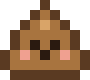</td>
<td><b>응가</b>: 산책하다가 가끔 응가를 해요. 25초 뒤에 저절로 사라지고, <b>눌러서 바로 치울 수도</b> 있어요.</td>
</tr><tr>
<td width="60" align="center"></td>
<td><b>선물 상자</b>: 하루에 두세 번 펫이 "선물을 가져왔어요!" 하고 상자를 들고 와요. 눌러 보면 <b>뽑기권(15%)</b>, <b>경험치 +5~15(50%)</b>, 아니면 <b>응가(35%, 꽝!)</b> 이 나와요. 지금 보고 있는 **모니터의 한가운데로 달려와서** 상자를 들고 기다려요. 3분 안에 누르지 않으면 사라지니 눈에 띄면 눌러 주세요.</td>
</tr></table>

- **마우스에 매달리기**: 마우스를 10초쯤 가만히 두면 달려와서 두 팔로 매달려요. 마우스를 움직이면 떨어져요.
- **높은 데서 떨어지면 기절**: 화면의 꽤 높은 곳에서 떨어지면(300px 이상) 바닥에서 **헤롱헤롱** 별이 돌며 잠깐 쉬어요. 이때는 돌봄도 받지 않아요.
- **벽 타기·졸기·잠자기·두리번거리기** 등 혼자서도 이것저것 해요.

## 성장과 레벨

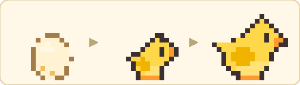

| 단계 | 조건 |
|---|---|
| 🥚 알 | 경험치 20 미만. 통통 튀고, 쓰다듬기만 할 수 있어요 |
| 🐣 새끼 | 경험치 20 이상 ~ 레벨 5 미만. 머리가 큰 아기 모습 |
| 🐾 성체 | 레벨 5 이상(경험치 160) |
| ✨ 전설 | **전설·히든 등급 동물만** 레벨 10에서 한 번 더 진화해요. 몸 둘레에 금빛 반짝임이 돌아요 |

뽑기로 얻은 동물은 알이 아니라 **새끼**로 바로 나와요. 경험치는 돌볼수록, 그리고 아래 일을 할수록 쌓입니다: 쓰다듬기·밥·놀기·씻기·산책, 업적 달성, 문제 고치기(개발자용), FE 지식 읽기.

### 레벨 등급 (10 레벨마다 색이 바뀌어요)

| 레벨 | 등급 | 색 |
|---|---|---|
| 1~9 | 새내기 | 🟤 갈색 |
| 10~19 | 숙련 | 🟢 초록 |
| 20~29 | 베테랑 | 🔵 파랑 |
| 30~39 | 달인 | 🟣 보라 |
| 40~49 | 명인 | 🟠 주황 |
| 50 이상 | 신화 | 🟡 금색 |

등급이 오르는 순간 펫이 "'숙련' 등급이 되었어요!" 하고 알려 줘요. 메뉴 머리말·내 펫 창·프로필 카드에서 레벨이 그 색으로 보입니다.

## 동물 모으기: 뽑기와 내 펫

우클릭 → **`🎟 뽑기…`**(뽑기만 하는 창)과 **`내 펫…`**(가진 동물을 보고 바꾸는 창)이 따로 있어요. 동물은 **뽑기로만** 얻어요. 뽑은 동물은 `내 펫`에 모이고, 그중 **한 마리만 꺼내서** 키웁니다. 동물마다 레벨·상태·이름이 따로 저장되고, 꺼내 두지 않은 동물은 시간이 멈춰 있어요. 아직 못 만난 동물은 `도감·기록…` 에서 볼 수 있어요.

### 뽑는 연출 (룰렛)

동물 뽑기나 꾸미기 뽑기를 누르면 칸들이 **가로로 드르륵 돌아요.** 점점 느려지다가 두 칸 사이에서 잠깐 멈칫한 뒤 한쪽이 골라져요(약 5초).

- 결과는 **서버가 확률대로 먼저 정하고**, 룰렛은 그 결과가 가운데에 멈추도록 보여 주기만 해요.
- 지나가는 칸은 `???` 가 아니라 **살짝 어두운 동물 모습**이에요. 등급 색으로 빛나서(일반 흰색 · 고급 초록 · 희귀 파랑 · 특별 보라 · 전설 주황 · 히든 무지개) 높은 등급이 지나가는 것을 알아볼 수 있어요.
- 결과는 **"여우가 나왔어요! (일반)"** 처럼 등급 이름에 색이 입혀져요. 히든은 글자가 무지개로 흘러요.
- 윈도우의 "동작 줄이기" 설정을 켜 두면 연출이 거의 바로 끝나요.

### 동물 31종과 등급

동물은 **등급**이 있고, 등급마다 확률이 달라요. 같은 등급 안에서는 똑같은 확률입니다. 히든 동물은 뽑기 전에는 모습도 이름도 비밀이에요(??? 로 보여요).


| | | | | | | |
|---|---|---|---|---|---|---|
| <br>토끼 | 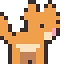<br>고양이 | 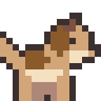<br>강아지 | 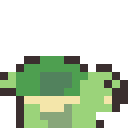<br>거북이 | 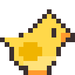<br>병아리 | 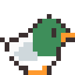<br>오리 | <br>여우 |


| | | |
|---|---|---|
| 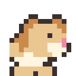<br>햄스터 | 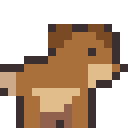<br>곰 | 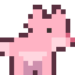<br>돼지 |


| | | | | | |
|---|---|---|---|---|---|
| 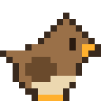<br>부엉이 | 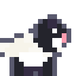<br>양 | 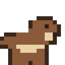<br>수달 | 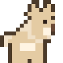<br>알파카 | 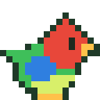<br>앵무새 | <br>너구리 |


| | | | | | |
|---|---|---|---|---|---|
| <br>판다 | <br>펭귄 | 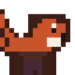<br>레서판다 | 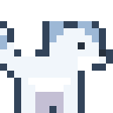<br>북극여우 | <br>공작 | 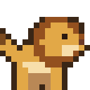<br>사자 |


| | | | |
|---|---|---|---|
| 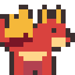<br>용 | 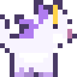<br>유니콘 | 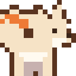<br>구미호 | 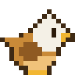<br>그리핀 |

: 이름과 모습이 비밀인 동물 5종     

### 등장 확률

| 등급 (색) | 동물 수 | 종당 확률 | 등급 합계 |
|---|---|---|---|
|  | 7종 | 약 7.1% | 50% |
|  | 3종 | 8% | 24% |
|  | 6종 | 약 2.5% | 15% |
|  | 6종 | 약 1.17% | 7% |
|  | 4종 | 0.75% | 3% |
|  | 5종 | 0.2% | 1% |

- **천장**: 전설이 계속 안 나오면 50번째 뽑기에서 반드시 **전설**이 나와요(히든은 천장 없이 낮은 확률로만 나와요). 전설이나 히든이 나오면 다시 0부터 세요. 뽑기 창에 남은 횟수가 보여요.
- 동물을 새로 추가해도 등급 합계는 그대로고, 그 등급의 종당 확률만 나뉘어요.
- **같은 동물이 또 나오면?** 그 동물의 중복 횟수가 늘고 경험치 +30을 받아요.
- 동물 뽑기는 **뽑기권 3장**, 꾸미기 뽑기는 **2장**이에요.
- 뽑기 확률과 결과는 **서버**가 정해요(로그인한 경우). 앱을 고쳐서 바꿀 수 없어요.

### 뽑기권은 어떻게 받나요?

FE 문제를 하나도 안 고쳐도 모입니다.

| 방법 | 받는 양 |
|---|---|
| 시작 선물 | 처음 시작하면 3장 |
| 출석 | 하루 첫 실행 때 1장 |
| 켜 두기 | 앱을 켜 두고 6시간이 쌓일 때마다 1장(하루 1장까지) |
| 돌봄 | 쓰다듬기·밥·놀기·씻기·산책을 25번 할 때마다 1장 |
| 레벨업 | 레벨 5·10·15… 에 2장, 레벨 8·13·18… 에 1장(동물마다 따로) |
| 새 버전 선물 | 새 버전으로 업데이트한 뒤 처음 켤 때마다 2장 |
| 선물 상자 | 하루 두세 번 오는 상자에서 15% 확률로 1장 |
| **친구** | 친밀도 레벨이 오를 때 **둘 다** 받아요(Lv2~10에 1~5장, 평생 최대 100장). 친구에게 1장씩 **선물**할 수도 있어요 → [친구와 친밀도](#친구와-친밀도) |

### 내 펫 창

우클릭 → **`내 펫…`**.

- 가진 동물만 보여요. **키우는 동물이 맨 앞**에 오고, 나머지는 레벨 높은 순이에요. 레벨·단계·이름·등급 이름표가 붙어요.
- **`꺼내기`** 를 누르면 지금 키우던 동물은 상태를 저장하고 쉬러 들어가요.
- 동물 이름은 [꾸미기](#꾸미기) 창에서 지어 줘요.

## 게임머니와 경매장

로그인하면 다른 사람과 펫을 사고팔 수 있어요. 펫 우클릭 → **`온라인` 탭 → `🏪 경매장…`**

- **게임머니**는 뽑기권과 별개의 재화예요. 경매장에서만 쓰고, 현금으로 바꿀 수는 없어요. 창 위쪽에서 지금 얼마 있는지 보여요.
- **얻는 법**: 돌봄 10번마다 5(하루 100까지) · 업적 하나당 30(하루 300까지) · **GitHub 기여 1건당 2(하루 40까지)** · **배움**(카드 확인 10 · 퀴즈 보너스 5 · 문제 고침 20 · FE 지식 읽기 2, 하루 150까지). 양과 상한은 서버가 정해서 앱을 고쳐도 늘릴 수 없어요.
- **동물 / 꾸미기**: 위쪽 탭으로 바꿔요. 줄마다 **미리보기 그림**이 있어요(동물은 그 레벨의 모습, 꾸미기는 지금 키우는 펫에게 입힌 모습). 등급 필터도 있어요.
- **사기**: 사면 바로 내 `내 펫`(꾸미기는 옷장)에 들어와요. 이미 가진 꾸미기는 살 수 없어요.
- **팔기**: `팔기` 탭에서 가격(1~1,000,000)을 적어 올려요. 팔리면 **수수료 없이** 가격만큼 받아요. 판매 중인 펫은 `내리기`로 거둘 수 있어요.
- 마지막 한 마리는 팔 수 없어요. 꾸미기는 **뽑기로만 얻는 것(25종)** 만 팔 수 있고, 업적으로도 열 수 있는 11종은 팔 수 없어요.
- **꾸미기 선물**: 친구 창의 `🎀 꾸미기 선물`로 친구에게 줄 수 있어요(하루 3번, 친밀도 +5). 친구끼리 꾸미기를 사고팔면 +10.
- **판매 알림**: 내 펫이 팔리면 펫이 말풍선으로 "누가 얼마에 샀는지" 알려 줘요(5분마다 확인).
- 등급은 판매 목록에도 표시돼요(일반·고급·희귀·특별·전설·히든).
- GitHub 기여는 로그인 직후와 1시간마다 서버가 확인해요. 바로 보고 싶으면 `☁ 내 아이디` → `GitHub 기여 지금 확인`. GitHub 기여 달력 기준이라 커밋 외에 PR·이슈도 세어져요.

## 친구와 친밀도

로그인하면 다른 사람과 **친구**가 될 수 있어요. 펫 우클릭 → **`온라인` 탭 → `👥 친구…`** (받은 요청이 있으면 숫자 뱃지가 떠요).

### 친구 맺기

1. 위쪽 칸에 친구의 **GitHub 아이디**를 적고 `요청 보내기`. 상대도 이 앱에 로그인한 적이 있어야 해요.
2. 상대가 `받은 요청`에서 **수락**하면 친구가 돼요. 서로 동시에 요청하면 바로 친구가 돼요.
3. 보낸 요청은 `요청 취소`, 받은 요청은 `거절`, 친구는 `친구 끊기`로 정리해요.
4. 새 요청이 오거나 친구가 되면 펫이 말풍선으로 알려 줘요(5분마다 확인).

### 친밀도와 레벨

친구마다 **친밀도 Lv**(1~10)이 있고, 카드에 레벨 배지(오를수록 색이 바뀌어요)와 다음 레벨까지의 진행 막대, 함께한 날 수가 보여요.

| 올리는 방법 | 친밀도 |
|---|---|
| **👋 인사하기** | 하루 한 번씩 각자. 기본 +3, 친구가 된 지 오래될수록 +1(30일마다, 최대 +3), 같은 날 서로 인사하면 +2 보너스 |
| **🎟️ 뽑기권 선물** | 뽑기권 1장을 보내면 +5. 하루에 한 친구에게 한 번, 전체로는 하루 세 번까지 |
| **🏪 경매장 거래** | 친구끼리 펫을 사고팔면 +10 |
| **🐾 데리고 다니기** | 한 시간에 한 번 +3(하루 6번까지) |
| **🎀 꾸미기 선물** | +5. 하루 3번까지 |

### 🐾 친구 펫 데리고 다니기

친구 카드의 **`🐾 데리고 다니기`** 를 누르면 그 친구의 대표 펫이 **내 펫의 절반 크기**로 내 펫 뒤를 따라다녀요(한 번에 한 친구). 친구 동의는 필요 없고, 종류와 레벨(모습)만 읽어 와요.

- 같이 다니는 동안 **한 시간에 한 번**, 하루 최대 6번: 내 펫 경험치 +6, 친구 펫 경험치 +6(친구가 앱을 켜면 가져가요), 친밀도 +3. 양과 횟수는 서버가 정해요.
- 벽을 타거나 마우스에 매달리면 잠시 숨어요.
- 끄고 싶으면 `설정 → 친구 펫`의 체크를 풀어요(보너스도 멈춰요). 친구 카드에서 `🐾 돌려보내기`로 그만둘 수도 있어요.

- 한 쌍이 하루에 올릴 수 있는 친밀도는 **40**까지예요(남용 방지).
- 레벨에 필요한 친밀도는 0 · 20 · 60 · 120 · 200 · 320 · 480 · 700 · 1000 · 1400 이에요.
- **레벨이 오르면 두 사람 모두 뽑기권**을 받아요: Lv2·3 = 1장, Lv4·5·6 = 2장, Lv7·8 = 3장, Lv9 = 4장, Lv10 = 5장. 같은 레벨 보상은 한 번만이고, 한 사람이 친구 레벨로 받을 수 있는 뽑기권은 **평생 최대 100장**이에요.
- 친구의 대표 펫(종류와 레벨)도 카드에 보여요.
- 업적도 있어요: **첫 친구 · 친구 부자(3명) · 단짝(Lv3) · 절친(Lv5) · 영혼의 단짝(Lv10)**.
- 보낸 요청은 한 번에 20개까지, 친구와 요청을 합쳐 100개까지예요.

## 꾸미기

우클릭 → **`내 펫` 탭 → `꾸미기…`**. 위쪽에는 **지금 키우는 펫의 미리보기와 이름 칸이 고정**돼 있고, 아래 목록만 스크롤돼요. 그래서 어떤 꾸미기를 입었는지 항상 보면서 고를 수 있어요. 색과 장식은 **그걸 입은 내 펫의 작은 그림**이 있는 옷장 칸으로 보여요.

- **이름**: 지금 키우는 동물에게 이름을 지어 줘요(12자까지). 메뉴 머리말과 프로필 카드에 나와요.
- **색**: 파스텔 / 진하게 / 흑백. 몸 색만 바뀌고 윤곽선과 눈은 그대로예요.
- **장식**: 아래 28종. 걷고 앉고 자는 모든 모습에서 머리나 등을 따라다녀요.
- **목 장식**: 방울 목줄·스카프·나비넥타이·진주 목걸이·별 목걸이·황금 목걸이(6종). 턱 밑에 걸려요.
- **효과**: 반짝이·하트·음표·눈송이·불꽃 오라(5종). 펫 둘레에 떠 있고, 불꽃 오라는 펫 모양을 따라 둘레를 감싸요.
- **소품**: 공·뼈다귀·생선·풍선·꽃 화분·나비·등불·용의 알(8종, 뽑기 전용·거래 가능). 공·뼈다귀·생선·화분·용의 알은 펫 앞에서 통통 튀고, 풍선·나비·등불은 머리 높이에서 둥실 떠 있어요. 벽을 타거나 마우스에 매달리면 숨어요.
- **모습(성장 단계)**: 이미 지나온 단계로만 되돌릴 수 있어요. 성체를 **새끼 모습**으로 돌렸다가 다시 성체로 바꿀 수도 있어요(알 단계는 고를 수 없어요). 경험치와 레벨은 그대로고 모습만 바뀌어요. 다른 동물로 바꾸면 `자동`으로 돌아가요.
- **프로필 카드에 보여 줄 펫**: 가진 동물 중에서 골라요. 아직 못 뽑은 히든 동물은 이름이 ??? 로 가려져 있어요.
- 모자류는 **어른 모습에서도 머리 맨 위에 얹혀요.** 어른은 머리가 위쪽에 있어서 키 큰 모자는 가운데를 줄여 낮게 그려요.

아직 못 연 장식은 점선과 자물쇠로 보이고, 눌러 보면 여는 방법을 알려 줘요. 업적으로 장식을 받으면 아무것도 안 달고 있을 때 바로 달아 줘요.

### 장식 얻는 방법

장식은 세 종류예요: ① **업적 또는 뽑기**로 얻는 것(8종), ② **뽑기 전용**(14종, 업적 없음 — 처음 4종과 새 머리 장식 10종), ③ **업적 전용**(6종, 뽑기에는 나오지 않음). 아래 표에는 업적과 관련된 장식을 적었어요. 뽑기 전용 장식은 다음 "꾸미기 뽑기와 등급"에 있어요.

| 모습 | 이름 | 얻는 방법 |
|---|---|---|
| 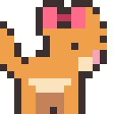 | 리본 | 업적 '다정한 친구' 또는 꾸미기 뽑기 |
| 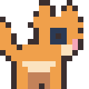 | 선글라스 | 업적 'FE 꿈나무' 또는 꾸미기 뽑기 |
| 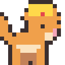 | 왕관 | 업적 '도감 완성' 또는 꾸미기 뽑기 |
| 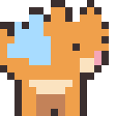 | 날개 | 업적 'FE 장인' 또는 꾸미기 뽑기 |
| 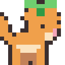 | 새싹 | 업적 '지식 수집가' 또는 꾸미기 뽑기 |
| 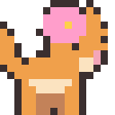 | 꽃 | 업적 '사흘 연속' 또는 꾸미기 뽑기 |
| 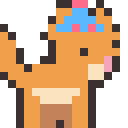 | 파티 모자 | 업적 '퀴즈 박사' 또는 꾸미기 뽑기 |
| 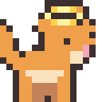 | 천사 고리 | 업적 '한 달 연속' 또는 꾸미기 뽑기 |
| 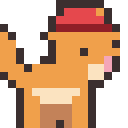 | 야구모자 | **뽑기 전용** — 꾸미기 뽑기로만 |
| 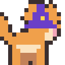 | 마법사 모자 | **뽑기 전용** — 꾸미기 뽑기로만 |
| 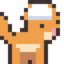 | 요리사 모자 | **뽑기 전용** — 꾸미기 뽑기로만 |
| 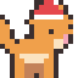 | 산타 모자 | **뽑기 전용** — 꾸미기 뽑기로만 |
| 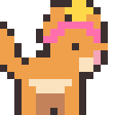 | 별 머리띠 | **업적 전용** — 업적 '금손 집사'(뽑기에는 없음) |
| 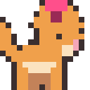 | 하트 더듬이 | **업적 전용** — 업적 '깔끔쟁이'(뽑기에는 없음) |
| 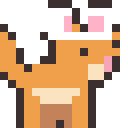 | 토끼 귀 | **업적 전용** — 업적 '산책 친구'(뽑기에는 없음) |
| 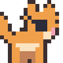 | 안대 | **업적 전용** — 업적 '동물 수집가'(뽑기에는 없음) |
| 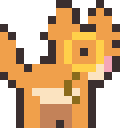 | 외알 안경 | **업적 전용** — 업적 '뽑기 단골'(뽑기에는 없음) |
| 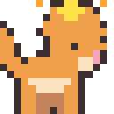 | 반짝 별 | **업적 전용** — 업적 '전설의 만남'(뽑기에는 없음) |

색은 `파스텔`(업적 '첫 수정'), `진하게`('열심히 배우는 중'), `흑백`('일주일 연속')으로 열리거나 꾸미기 뽑기로 얻어요.

### 꾸미기 뽑기와 등급

꾸미기 뽑기(**뽑기권 2장**)에도 동물처럼 **등급**이 있어요. 뽑기에 나오는 꾸미기는 모두 **36종**이에요(업적 전용 6종 제외).

- **안 가진 것만 나와요.** 같은 것이 두 번 나오지 않아서 뽑을수록 모으는 재미가 커지고, 다 모으면 더 뽑을 수 없어요.
- 먼저 **안 가진 것이 남은 등급 중에서** 등급을 고르고(일반 50 · 고급 24 · 희귀 15 · 특별 7 · 전설 3 · 히든 1의 비율), 그 등급에서 하나를 골라요. 한 등급을 다 모으면 남은 등급끼리 나눠요.
- **천장**: 전설이 안 나온 채 25번 뽑으면 다음은 안 가진 전설이 나와요(전설을 다 모았으면 해당 없음).
- 룰렛도 돌아요. 지나가는 칸이 등급 색으로 빛나고, 결과는 "마법사 모자를 얻었어요! (희귀)"처럼 등급 이름에 색이 입혀져요. 전설·히든은 결과 칸에 **아우라 애니메이션**이 나와요.
- 꾸미기 창의 칸 아래쪽에도 **등급 색 줄**이 그어져 있어요.
- **특별 이상 등급**은 몸보다 세밀한 **1칸 도트 디테일**(밝은 면·어두운 면·보석의 반짝임·불똥)이 더해져요.

****

| | | | | | | | |
|---|---|---|---|---|---|---|---|
| <br>리본 | <br>새싹 | <br>꽃 | <br>야구모자 | 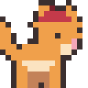<br>베레모 | 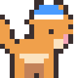<br>비니 | 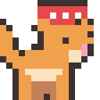<br>두건 | 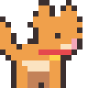<br>방울 목줄 |
| 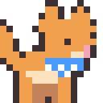<br>스카프 |  |  |  |  |  |  |  |

****

| | | | | | | | |
|---|---|---|---|---|---|---|---|
| <br>파티 모자 | <br>선글라스 | <br>요리사 모자 | <br>산타 모자 | 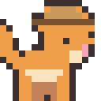<br>카우보이 모자 | 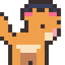<br>헤드폰 | 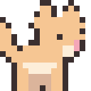<br>파스텔 색 | 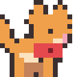<br>나비넥타이 |
| 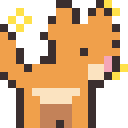<br>반짝이 | <br>하트 |  |  |  |  |  |  |

****

| | | | | | | | |
|---|---|---|---|---|---|---|---|
| <br>마법사 모자 | <br>천사 고리 | <br>해적 모자 | <br>기사 투구 | <br>진하게 색 | <br>진주 목걸이 | <br>음표 | <br>눈송이 |

****

| | | | | | | | |
|---|---|---|---|---|---|---|---|
| <br>왕관 | <br>악마 뿔 | <br>유니콘 뿔 | <br>흑백 색 | <br>별 목걸이 |  |  |  |

****

| | | | | | | | |
|---|---|---|---|---|---|---|---|
| <br>날개 | <br>불꽃 왕관 | <br>황금 목걸이 | <br>불꽃 오라 |  |  |  |  |

## 업적과 도감

우클릭 → **`도감·기록…`** 에서 연속 사용 기록, 배운 문제 종류(도감), 업적 28개를 볼 수 있어요.

- **연속 사용**: 쓰다듬기·밥·놀기·씻기·배움 카드 확인·문제 고치기·지식 읽기 중 **하나라도 한 날**을 하루로 세요(앱만 켜 둔 날은 안 세요). 하루를 통째로 빠지면 현재 기록이 0 으로 돌아가요(최고 기록은 남아요).
- **업적**: 조건을 채우면 펫이 알려 주고 **경험치**를 줘요(업적마다 한 번).

| 업적 | 조건 | 보상 경험치 |
|---|---|---|
| 첫 배움 | 배움 카드를 처음 확인했어요 | +5 |
| 열심히 배우는 중 | 배움 카드를 10번 확인했어요 | +15 |
| FE 꿈나무 | 배움 카드를 50번 확인했어요 | +40 |
| 퀴즈 척척 | 확인 퀴즈를 5번 맞혔어요 | +10 |
| 퀴즈 박사 | 확인 퀴즈를 25번 맞혔어요 | +30 |
| 첫 수정 | 펫이 찾은 문제를 처음 고쳤어요 | +10 |
| 문제 해결사 | 찾은 문제를 10개 고쳤어요 | +30 |
| FE 장인 | 찾은 문제를 30개 고쳤어요 | +80 |
| 다섯 가지 기본기 | 서로 다른 문제 5종을 배웠어요 | +20 |
| 열 가지 기본기 | 서로 다른 문제 10종을 배웠어요 | +40 |
| 도감 완성 | 모든 종류의 문제를 한 번씩 배웠어요 | +100 |
| 지식 수집가 | FE 지식을 10개 읽었어요 | +10 |
| 지식 박사 | 모든 FE 지식을 읽었어요 | +50 |
| 사흘 연속 | 3일 연속으로 펫과 함께했어요 | +10 |
| 일주일 연속 | 7일 연속으로 펫과 함께했어요 | +30 |
| 한 달 연속 | 30일 연속으로 펫과 함께했어요 | +100 |
| 다정한 친구 | 쓰다듬고, 밥 주고, 놀아 준 횟수가 50번이에요 | +10 |
| 금손 집사 | 돌봐 준 횟수가 200번이에요 | +60 |
| 깔끔쟁이 | 펫을 20번 씻겼어요 | +30 |
| 산책 친구 | 산책을 10번 다녀왔어요 | +30 |
| 동물 수집가 | 서로 다른 동물을 5종 모았어요 | +40 |
| 뽑기 단골 | 동물 뽑기를 10번 했어요 | +40 |
| 전설의 만남 | 히든 동물을 처음 만났어요 | +80 |
| 첫 친구 | 친구를 처음 사귀었어요 | +10 |
| 친구 부자 | 친구가 3명이 되었어요 | +25 |
| 단짝 | 친구와 친밀도 레벨 3이 되었어요 | +25 |
| 절친 | 친구와 친밀도 레벨 5가 되었어요 | +50 |
| 영혼의 단짝 | 친구와 친밀도 레벨 10이 되었어요 | +150 |

## 프로필 카드

내가 키운 펫이 계단과 집이 있는 작은 마을을 돌아다니는 **움직이는 카드**를 GitHub 프로필에 걸 수 있어요. 카드 아래에는 레벨(등급 색)·경험치·연속일·도감·업적 기록이 붙어요.


**방법 1 — 로그인해서 주소로 붙이기(권장)**: 맨 위의 [내 펫을 GitHub 프로필에 붙이기](#내-펫을-github-프로필에-붙이기-1분)를 따라 하세요. 서버가 그린 카드라서 레벨이 올라가면 저절로 바뀌어요. 서버 카드에는 꾸미기(모자·색)·이름·연속일·도감·업적 수까지 반영돼요(값은 앱을 쓰는 동안 몇 초 뒤에 올라가요).

**방법 2 — 파일로 직접 올리기(로그인 필요 없음)**:

1. 펫 우클릭 → **`프로필 카드 내보내기…`** 로 `pet-card.svg` 를 저장합니다.
2. 내 프로필 저장소(`<내 아이디>/<내 아이디>`)의 `assets` 폴더에 올립니다.
3. 프로필 `README.md` 에 아래 한 줄을 넣습니다.

```html
<a href="https://github.com/junhooo111/desktop-tamagotchi"></a>
```

카드는 **내보낸 순간의 모습**이에요. 레벨이나 장식이 바뀌면 다시 내보내서 덮어쓰세요. 꾸미기 창에서 가진 동물 중 **카드에 나올 동물**을 고를 수 있고, 카드에는 그 동물 자신의 레벨이 나와요.

## 우클릭 메뉴 한눈에 보기

펫을 우클릭하면 **도트 스타일 메뉴**가 떠요. 마우스뿐 아니라 키보드(방향키·Enter·Esc)로도 쓸 수 있어요. 메뉴 밖을 누르면 닫혀요.

| 자리 | 들어 있는 것 |
|---|---|
| **맨 위 머리말** | 펫 이름·레벨 등급과 경험치·배부름·기분·청결 막대(예전의 `상태 보기`) |
| **돌보기 버튼 5개** | 쓰다듬기 · 밥 주기 · 놀아주기 · 씻기기 · 산책하기 |
| 탭 **내 펫** | 꾸미기… · 내 펫… · 🎟 뽑기…(뽑기권 수) · 도감·기록… · 혼자 놀게 두기(여기서만) / 자유롭게 돌아다니게 하기 · 프로필 카드 내보내기… |
| 탭 **온라인** | 👥 친구… · 🏪 경매장… · 🏆 랭킹…(로그인한 사람끼리) · ☁ GitHub 로그인 / 내 계정(맞추기·기여 확인·카드 주소 복사·로그아웃) |
| 탭 **개발** | 지금 검사하기 · 검사 결과… · 오늘의 FE 지식 · 검사 도구(검사용 브라우저·검사 체험·크롬 확장 폴더) |
| **아래 줄** | ⚙ 설정 · 🔔 공지 · ⋯ 더보기(업데이트 확인·로그인할 때 자동 실행·동작 보기(테스트용)·버전) · ⏻ 종료 |
| 새 버전이 준비되면 | 머리말 아래에 **새 버전 설치하고 다시 시작** 줄이 나타나요 |

작업 표시줄 트레이 아이콘의 메뉴도 같은 내용이에요(탭이 하위 메뉴로 보여요).

## 설정과 업데이트

우클릭 → **`설정…`**. 바꾸면 바로 적용·저장돼요.

| 항목 | 선택지 | 설명 |
|---|---|---|
| 펫 크기 | 1배(기본) / 2배 / 3배 | 1배가 마우스 커서 정도예요 |
| 문제 검사 | 켜기 / 끄기 | 끄면 펫은 놀기만 해요 |
| 검사 주기 | 5·10(기본)·30·60초 | 열려 있는 로컬 페이지를 살피는 간격 |
| 언어 | 자동(기본) / 한국어 / English | 자동은 이 PC 의 언어·지역을 따라요(한국어 또는 지역이 한국이면 한국어, 아니면 영어). 메뉴·말풍선·창·검사 카드·FE 지식이 바뀌어요 |
| FE 지식 알림 | 끄기 / 10 / 20(기본) / 60분 | 가만히 있을 때 지식 말풍선을 띄우는 간격 |
| 검사할 규칙 | 규칙별 켜기·끄기 | 끈 종류의 문제는 알리지 않아요 |
| 자동 업데이트 | 켜기(기본) / 끄기 | 새 버전을 알려 주고 받아 둬요 |
| 공지 | 켜기(기본) / 끄기 | 새 공지가 있으면 펫이 알려 줘요 |

- **업데이트**: 새 버전이 나오면 받아 두고 말풍선(과 Windows 알림)으로 알려 줘요. 앱을 끌 때 자동 설치되고, 우클릭의 `새 버전 … 설치하고 다시 시작`을 누르면 바로 설치돼요. 업데이트 기능은 0.4.0부터 있어서 그보다 오래된 버전은 한 번 직접 새로 설치해야 하고, 기록은 그대로 남아요.
- **공지**: 새 소식이 있으면 가끔 펫이 말풍선으로 알려 줘요. 내 정보는 보내지 않고 공지 파일을 읽기만 해요.

## 놓친 기본기 알려 주기 (개발자용)

내가 만드는 웹 화면(`localhost`)을 펫이 살펴서, AI로 화면을 만들 때 놓치기 쉬운 기본기 **50가지**를 찾아 줘요: 이미지 설명(alt)·버튼 이름·입력칸 라벨·문서 언어·제목 순서·누르는 영역 크기·글자 대비·가로 넘침·중복 id·화면 확대 막음·표 제목·검색 설명·iframe 제목·본문 영역(main)·자동 재생 소리·자동 완성(autocomplete)·키보드 포커스 표시·색약을 위한 링크 구분·영상 자막 같은 유니버설 디자인 항목까지 스크린 리더·키보드·시각·청각·인지 분류로 나눠서 검사해요 …

- 문제를 찾으면 펫이 그 자리로 달려가 `!` 를 띄우고 **무엇이 문제인지 · 어디인지 · 어떻게 고치는지**를 말풍선으로 알려 줘요.
- 말풍선이 떠 있을 때 펫을 클릭하면 **배움 카드**(원리·해결·코드 예시·확인 퀴즈)가 열려요. 확인하면 경험치 +10(퀴즈를 맞히면 +5 더), 실제로 **고치면 +20**이에요.
- 가끔(20분에 한 번) 펫이 **FE 지식**도 하나씩 알려 줘요(`확인` 을 누르면 경험치 +2, 69개 내장: 성능·CSS·JS/TS·React·보안·접근성·네트워크·SEO).
- 시작하는 가장 쉬운 방법: 알이 부화한 뒤 우클릭 → `검사 도구` → **`검사 체험`**. 내 프로젝트는 `검사용 브라우저 열기`로 주소를 열거나, 평소 쓰는 크롬에 **확장 프로그램**을 한 번 설치해 쓸 수 있어요.

설치 방법·규칙 전체 목록·무시하는 법·한계는 **[페이지 검사 사용 가이드](docs/inspection-guide.md)** 에 자세히 있어요.

## 개인정보와 안전

- **로그인하지 않으면 내 PC 밖으로 나가는 것이 없어요.** 통계·광고가 없고, 검사한 내용도 밖으로 보내지 않아요. (새 버전·공지를 확인하려고 이 저장소의 공개 파일을 읽을 뿐이에요.)
- **로그인(선택)하면** GitHub 이름·아바타 주소(표시용)와 진행 기록(가진 동물·경험치·뽑기권·꾸미기·도감 파일)이 내 계정으로 서버(Supabase)에 저장돼요. 이메일은 저장하지 않아요. 비밀번호는 쓰지 않고(GitHub 로그인), 로그인 정보는 이 PC 의 보안 저장소에 암호화돼 있어요. 랭킹과 프로필 카드에는 GitHub 이름·펫과 꾸밈·점수(연속일·도감·업적 수)만 보이고, 언제든 끌 수 있어요. 경매장에는 판매자 GitHub 이름·펫 종류·등급·레벨·가격만 보여요. 친구에게는 내 GitHub 이름과 아바타, 대표 펫(종류·레벨), 함께한 날, 친밀도만 보여요. GitHub 기여 수는 서버가 공개 기여 달력에서 읽고, 서버가 쓰는 읽기 전용 토큰은 앱에 들어 있지 않아요. 검사한 페이지 내용은 로그인해도 서버로 보내지 않아요.
- 페이지 검사는 `localhost`·`127.0.0.1`·`*.localhost` 주소의 탭만 봐요. 다른 사이트에는 연결조차 하지 않아요.
- 크롬 확장은 권한이 최소예요(쿠키·방문 기록 없음). 이 PC 의 펫 앱으로 "문제 목록"만 보내고 페이지 내용이나 입력값은 보내지 않아요.
- 이 PC 에는 펫 기록과(로그인했다면) 서버에 올리기 전 백업(`backups` 폴더)이 저장돼요(`%APPDATA%\desktop-tamagotchi`).

## 문제 해결과 자주 묻는 질문

### 펫이 안 보여요

- 작업 표시줄 트레이(오른쪽 아래 `^`)에 아이콘이 있으면 앱은 켜져 있는 거예요. 우클릭해서 메뉴가 나오는지 보세요.
- 앱은 **한 번에 하나만** 실행돼요. 이미 떠 있으면 다시 실행해도 새 창이 안 떠요. `종료` 후 다시 실행해 보세요.
- **다른 모니터**로 가 있을 수 있어요. 전체 화면 앱(게임·전체 화면 영상) 위에는 안 보일 수 있어요.

### 클릭이 안 돼요

펫의 **몸 위**를 클릭해야 해요. 몸 주변의 빈 곳은 일부러 클릭이 아래 창으로 통과해요.

### 설치 파일이 막혀요

- Windows SmartScreen: `추가 정보` → `실행`.
- 백신이 차단: 서명 없는 앱이라 일부 백신이 의심할 수 있어요. 예외로 등록하거나 소스에서 직접 빌드해서 쓰세요([개발자 문서](docs/development.md)).

### 처음부터 다시 키우고 싶어요

앱을 `종료`한 뒤 `%APPDATA%\desktop-tamagotchi` 폴더를 지우고 다시 실행하면 새 알로 시작해요(뽑기권·컬렉션도 처음으로 돌아가요).

### 자주 묻는 질문

**Q. 펫이 작업을 방해하지 않나요?** 펫 몸이 아닌 부분은 클릭이 통과하고, 마우스를 가만히 두면 매달리는 것 외에는 마우스를 건드리지 않아요. 크기는 설정에서 바꿀 수 있어요.

**Q. 컴퓨터 성능을 많이 쓰나요?** 작은 캔버스에 도트를 그리는 정도예요.

**Q. 뽑기권을 못 쓰고 있어도 되나요?** 네, 쌓아 둬도 사라지지 않아요.

**Q. 친구 요청이 안 가요.** 상대가 이 앱에 GitHub 로그인을 한 번이라도 해야 아이디를 찾을 수 있어요. 아이디 앞의 `@` 는 있어도 없어도 돼요.

**Q. 룰렛 연출이 길어요.** 윈도우의 `설정 ▸ 접근성 ▸ 시각 효과 ▸ 애니메이션 효과`를 끄면 거의 바로 끝나요.

**Q. 방치하면 펫이 죽나요?** 아니요. 배고프고 지저분해질 뿐이고, 돌봐 주면 회복돼요.

**Q. 펫 이름을 바꿀 수 있나요?** 꾸미기 창에서 언제든지 바꿀 수 있어요.

**Q. 프레임워크(React·Vue …)와 상관있나요?** 페이지 검사는 브라우저에 그려진 결과(DOM)를 보므로 프레임워크와 무관해요. 배포된 실제 사이트는 안전을 위해 일부러 검사하지 않아요.

**Q. 페이지 검사가 안 돼요.** [검사 가이드의 문제 해결](docs/inspection-guide.md#검사-문제-해결)을 보세요.

## 더 알아보기

- [페이지 검사 사용 가이드](docs/inspection-guide.md)
- [개발자 문서](docs/development.md)(직접 빌드·테스트·릴리스·구조)
- [컨셉](docs/concept.md) · [앞으로의 계획(웹사이트·로그인·거래)](docs/platform-design.md) · [작업 기록](docs/worklog.md)
- 라이선스: [MIT](LICENSE)
