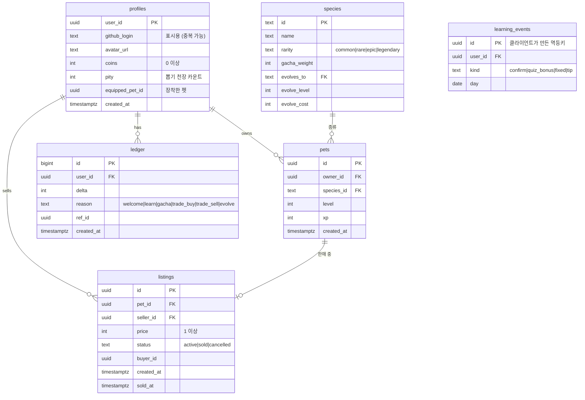

# 플랫폼 설계: 로그인·펫 수집·거래·뽑기·진화

> 상태: 설계 확정, **DB(스키마·권한·서버 함수·테스트)는 구현 완료**, 웹·데스크톱 로그인은 아직.
> 영감: [gitanimals](https://github.com/git-goods/gitanimals) — GitHub 로그인, 펫 수집·거래·진화·뽑기, 프로필 README 카드.

## 0. 결정과 진행 상황

**결정**
- **한 레포에 전부 둔다**(프론트엔드·DB/서버 함수·데스크톱 앱). 폴더 구성은 아래와 같다. 지금 레포를 `apps/`·`packages/` 로 통째로 옮기는 작업은 하지 않고, 필요해질 때 한다(직접 테스트하기 어려운 시점에 잘 돌던 앱을 건드리는 위험을 피하기 위해).
- 서버는 Supabase 를 쓰고, 서버 로직은 DB 함수(RPC)에만 둔다.

```
desktop-tamagotchi/
├─ src/ static/ scripts/ …   데스크톱 앱 (지금 그대로, 루트)
├─ supabase/                  DB: 마이그레이션(스키마·권한·함수) + SQL 테스트   ← 구현됨
│  ├─ migrations/0001_schema.sql · 0002_seed_species.sql · 0003_functions.sql
│  └─ tests/                  PGlite(실제 Postgres)로 도는 테스트
├─ web/                       웹사이트 (P1 에서 추가)
└─ docs/
```
- 웹은 `src/shared` 의 도트·레벨 규칙을 별칭(alias)으로 가져다 쓴다(복사하지 않는다).

**진행 상황**
- ✅ P0 일부: 구조 확정, 마이그레이션 폴더, SQL 테스트 환경(Docker 없이 PGlite).
- ✅ DB 전부: 테이블·RLS·서버 함수 7개·펫 6종 시드, **SQL 테스트 82건 통과**.
- ⬜ Supabase 프로젝트·GitHub OAuth App 만들기(사용자가 직접, 12장), 웹, 데스크톱 로그인.

**설계에서 구현하며 달라진 점**
- `github_login` 은 **유일하지 않다**. GitHub 이름을 바꾸면 다른 사람이 같은 이름을 쓸 수 있어서, 유일 제약이 있으면 가입이 막힌다. 사용자는 항상 `user_id` 로 가리킨다.
- 거래 수수료는 원장에 따로 남기지 않는다(어디로도 가지 않고 사라진다). 사용자별 `재화 = 원장 합계` 는 그대로 성립한다.
- 가입하면 **환영 재화 100**(뽑기 1회)을 준다(원장 `welcome`).
- 레벨은 `pets.level` 생성 열(`1 + floor(sqrt(xp/10))`)이고, 앱의 `levelOf` 와 같은 값이 나오는지 테스트로 확인한다.
- 학습 보고의 하루 상한(150)은 별도 카운터 없이 **원장의 오늘(UTC) `learn` 합계**로 계산한다.
- 알려진 한계: PGlite 는 연결이 하나라서 **진짜 동시 접속 경쟁은 시험하지 못한다.** 행 잠금(`for update`)과 고정된 잠금 순서로 설계했고, "두 번째 구매자는 실패"는 순차 실행으로 확인했다. 실제 Supabase 프로젝트가 생기면 동시 호출 테스트를 추가한다.

## 1. 한눈에 보기

데스크톱 펫(지금 만든 앱)은 그대로 두고, **웹사이트 + 서버 역할을 하는 클라우드 DB**를 더해서 사용자가 GitHub 로그인으로 자기 펫을 모으고, 뽑고, 사고팔고, 진화시키게 합니다.

```mermaid
flowchart LR
  subgraph User[사용자 PC]
    D[데스크톱 펫<br/>Electron]
    B[브라우저]
  end
  W[웹사이트<br/>정적 호스팅]
  subgraph SB[Supabase]
    A[Auth<br/>GitHub 로그인]
    P[(Postgres<br/>테이블 + RLS)]
    F[[DB 함수 RPC<br/>뽑기·거래·진화·보상]]
    E[Edge Function<br/>README 카드 SVG]
  end
  B --> W
  W -->|로그인| A
  W -->|읽기: 내 펫·마켓| P
  W -->|쓰기: RPC 호출만| F
  D -->|로그인(딥링크)| A
  D -->|학습 이벤트 보고| F
  F --> P
  GH[GitHub 프로필 README] -->|이미지 요청| E
  E --> P
```

핵심 원칙 하나: **클라이언트는 테이블을 직접 고치지 못하고, 서버 함수(RPC)만 부른다.** 재화·펫·거래는 전부 그 함수 안에서 검증하고 처리한다.

## 2. 목표와 비목표

**목표**
- GitHub 로그인으로 계정 만들기(비밀번호 없음).
- 내 펫 목록, 장착한 펫을 웹과 데스크톱 앱에서 같이 보기.
- 학습(배움 카드 확인, 문제 고침, 지식 읽기)으로 재화·경험치 얻기.
- 뽑기, 사용자 간 거래, 진화.
- (후순위) GitHub 프로필 README에 붙이는 펫 이미지 카드.

**비목표(하지 않는 것)**
- 현금·실제 돈과 연결되는 거래. 재화는 게임 안에서만 쓰고 현금화 수단을 만들지 않는다.
- 직접 운영하는 서버(Spring 같은 백엔드). 서버 로직은 DB 함수로만 둔다.
- 완벽한 부정 방지. 장난감 규모에 맞춰 "쉽게 속일 수 없게" 하는 수준까지만 한다(7장).
- 길드, 배경 상점(gitanimals의 다른 기능). 필요해지면 뒤에서.

## 3. 기술 선택

| 영역 | 선택 | 이유 |
|---|---|---|
| 서버 역할 | **Supabase**(Postgres + Auth + RLS + RPC + Edge Function) | GitHub 로그인 내장, 서버 프레임워크를 따로 짤 필요 없음, 프론트엔드 개발자에게 익숙한 SDK |
| 웹사이트 | React + TypeScript(Vite) → 정적 호스팅(Cloudflare Pages 또는 Vercel) | 서버 렌더링이 필요 없고 배포가 가장 단순 |
| 데스크톱 | 지금 앱 그대로 + 로그인·동기화 추가 | 오프라인에서도 로컬 펫으로 동작(로그인은 선택) |
| 코드 공유 | 한 레포 안에서 `src/shared` 를 웹이 별칭으로 가져다 씀 | 앱과 웹이 같은 그림·레벨 규칙을 써야 하고, 폴더를 통째로 옮기는 위험을 피함(0장) |
| DB 테스트 | Supabase CLI(로컬) 또는 개발용 프로젝트에서 SQL 테스트 | RLS·거래 같은 핵심 로직을 코드 없이 믿을 수 없으므로 테스트 필수 |

> 무료 플랜의 일시정지·한도 같은 정책은 시작할 때 최신 내용을 다시 확인한다.

## 4. 데이터 모델



- **ledger(원장)**: 재화가 변하는 모든 순간을 한 줄씩 남기는 추가 전용 기록. 잔액이 이상해지면 원장으로 다시 계산해서 검증한다.
- **learning_events**: 데스크톱 앱이 보내는 학습 이벤트. `id` 를 멱등키로 써서 같은 이벤트를 두 번 보내도 한 번만 인정한다.
- **species**: 뽑기 확률과 진화 규칙을 담은 카탈로그. 모든 사용자가 읽을 수 있다.
- 경험치→레벨 공식은 **SQL 이 기준**이다. 앱의 `levelOf` 와 같은 공식을 쓰고 테스트로 일치를 확인한다.

## 5. 권한 설계(RLS)

| 테이블 | 읽기 | 쓰기 |
|---|---|---|
| `species` | 누구나 | 없음(관리자가 마이그레이션으로만) |
| `profiles` | 본인 전체 / 타인은 공개 뷰(`github_login`, `avatar_url`)만 | 직접 쓰기 없음(RPC 만) |
| `pets` | 본인 것 + 판매 중인 펫 | 직접 쓰기 없음(RPC 만) |
| `listings` | `active` 만 누구나 | 직접 쓰기 없음(RPC 만) |
| `ledger` | 본인 것만 | 직접 쓰기 없음(RPC 만) |
| `learning_events` | 본인 것만 | 직접 쓰기 없음(RPC 만) |

- 모든 테이블에 RLS 를 켜고, **insert/update/delete 정책을 아예 만들지 않는다.** 그러면 클라이언트는 어떤 경로로도 쓸 수 없다.
- 쓰기는 전부 `security definer` 함수가 한다. 함수는 `set search_path = ''` 로 고정하고, 첫 줄에서 `auth.uid()` 가 있는지 확인한다.
- 함수 실행 권한은 `anon` 에서 회수하고 `authenticated` 에만 준다.
- 잔액은 `check (coins >= 0)` 제약으로 한 번 더 막는다.
- **서비스 키는 클라이언트에 절대 두지 않는다.** 웹·앱에는 공개용(anon) 키만 쓴다.

## 6. 서버 함수(RPC) 설계

| 함수 | 하는 일 | 핵심 검증 |
|---|---|---|
| `report_learning(events jsonb, device_id)` | 학습 이벤트를 받아 재화·경험치 지급 | 이벤트 종류만 받고 **양은 서버가 정한다**, 멱등키 중복 무시, 하루 상한 |
| `gacha_pull()` | 재화를 내고 펫 뽑기 | 잔액 확인, 서버에서 확률 계산, 천장(pity) 적용 |
| `create_listing(pet_id, price)` | 펫을 마켓에 올림 | 내 펫인지, 이미 판매 중이 아닌지, 가격 범위 |
| `cancel_listing(listing_id)` | 판매 취소 | 내 판매글인지 |
| `buy_listing(listing_id)` | 구매 | 아래 거래 흐름 |
| `evolve_pet(pet_id)` | 진화 | 내 펫, 레벨 조건, 재화 |
| `equip_pet(pet_id)` | 데스크톱·웹에 보일 펫 선택 | 내 펫인지, 판매 중이 아닌지 |

**거래(`buy_listing`)는 한 트랜잭션 안에서 아래를 모두 하거나 하나도 하지 않는다.**

```sql
-- 초안(구현 때 다듬는다)
create function public.buy_listing(p_listing_id uuid) returns void
language plpgsql security definer set search_path = '' as $$
declare
  v_l   public.listings;
  v_fee int;
begin
  if auth.uid() is null then raise exception 'not_authenticated'; end if;

  select * into v_l from public.listings
   where id = p_listing_id and status = 'active'
   for update;                                   -- 같은 판매글을 두 사람이 동시에 사지 못하게 잠근다
  if not found then raise exception 'listing_unavailable'; end if;
  if v_l.seller_id = auth.uid() then raise exception 'own_listing'; end if;

  v_fee := floor(v_l.price * 0.05);              -- 수수료 5%: 재화가 계속 늘기만 하는 것을 막는다(소각)

  -- 두 지갑을 항상 같은 순서(user_id 순)로 잠가서 교착을 피한다
  perform 1 from public.profiles
   where user_id in (auth.uid(), v_l.seller_id) order by user_id for update;

  update public.profiles set coins = coins - v_l.price            where user_id = auth.uid();   -- 부족하면 check 제약 위반 → 전체 롤백
  update public.profiles set coins = coins + v_l.price - v_fee    where user_id = v_l.seller_id;
  update public.pets     set owner_id = auth.uid()                where id = v_l.pet_id;
  update public.listings set status = 'sold', buyer_id = auth.uid(), sold_at = now() where id = v_l.id;

  insert into public.ledger(user_id, delta, reason, ref_id) values
    (auth.uid(),     -v_l.price,         'trade_buy',  v_l.id),
    (v_l.seller_id,  v_l.price - v_fee,  'trade_sell', v_l.id);
end $$;
```

- 판매 중인 펫에는 `listings` 에 `active` 행이 하나뿐이어야 하므로 **부분 유일 인덱스**(`pet_id` 에서 `status='active'`)를 둔다.
- 장착 중인 펫을 올리면 장착을 자동으로 푼다.

## 7. 재화와 부정 방지

**재화를 얻는 길(모두 학습)**

| 이벤트 | 지급 | 비고 |
|---|---|---|
| 배움 카드 확인 | 코인 +10 | 퀴즈 정답이면 `quiz_bonus` +5 |
| 확인했던 문제를 고침 | 코인 +20 | 한 문제에 한 번 |
| 새 FE 지식 읽기 | 코인 +2 | 지식마다 한 번 |

- 양은 **서버가 정한다.** 앱은 "무슨 일이 있었는지"(kind)만 보내고 금액은 보내지 않는다. 앱이 변조돼도 금액은 못 키운다.
- **하루 상한**: 계정당 하루 얻을 수 있는 코인에 상한을 둔다(예: 150).
- **뽑기 비용**: 100 코인. 천장: 10번 연속 일반 등급이면 다음은 희귀 이상 확정(수치는 구현 때 조정).
- **수수료 5%**: 거래마다 일부를 소각해 재화 인플레이션을 누른다.

**막을 수 있는 것 / 막을 수 없는 것**

| 시도 | 대응 |
|---|---|
| 클라이언트에서 금액·확률 조작 | 서버가 계산하므로 불가 |
| 같은 이벤트 반복 전송 | 멱등키로 무시 |
| 요청을 매크로로 쏘기 | 하루 상한 + 함수별 최소 간격(쿨다운) |
| 두 번 동시 구매 | 행 잠금으로 한 명만 성공 |
| **"학습한 척" 이벤트 위조** | ⚠️ 완전히는 못 막는다. 상한으로 피해를 제한할 뿐이다 |
| 여러 계정으로 코인 모으기 | ⚠️ 못 막는다. 현금성이 없으므로 피해가 없다는 점이 안전장치다 |

이 한계가 있으므로 재화는 **현금화 수단을 만들지 않는다**(2장 비목표).

## 8. 로그인 흐름

### 웹사이트
1. `로그인` → Supabase Auth 가 GitHub OAuth 로 보낸다.
2. 승인하면 돌아와서 세션이 만들어진다. 첫 로그인이면 DB 트리거가 `profiles` 행을 만든다(`github_login`, `avatar_url`).
3. GitHub OAuth App 의 **클라이언트 시크릿은 Supabase 대시보드에만** 둔다(코드·레포에 넣지 않는다).
4. 요청 권한(scope)은 최소(`read:user`). GitHub 토큰은 우리가 저장하지 않는다.

### 데스크톱 앱 (브라우저 로그인 + 딥링크)
1. 앱의 `로그인` → 기본 브라우저로 로그인 페이지를 연다(PKCE 사용).
2. 로그인이 끝나면 `desktop-tamagotchi://auth?...` 로 앱에 돌아온다(Electron 의 프로토콜 핸들러).
3. 앱이 코드를 세션으로 바꾸고, **리프레시 토큰은 OS 보안 저장소**(Electron `safeStorage`)에 암호화해서 보관한다.

> 앞에서 "GitHub 기기 인증(Device Flow)을 쓰면 된다"고 했는데 다시 보니 보정이 필요하다. Device Flow 로 얻는 건 GitHub 토큰이고, 이것을 Supabase 세션으로 바꾸려면 서버 함수를 따로 짜야 한다. **브라우저 로그인 + 딥링크가 서버 코드 없이 되는 표준 방식**이라 이쪽을 택한다.

### 오프라인
- 로그인하지 않아도 지금처럼 로컬 펫이 동작한다.
- 로그인하면 **서버의 장착 펫이 데스크톱에 나온다.** 로컬 펫과 합치지 않는다(규칙을 단순하게 유지; 합치기는 충돌이 많아 하지 않는다).

## 9. 단계 계획

| 단계 | 내용 | 끝났다고 보는 기준 |
|---|---|---|
| **P0** | 구조 확정, Supabase 프로젝트·GitHub OAuth App 만들기(사용자가 직접), 마이그레이션 폴더 | 빈 프로젝트에서 로그인 성공 |
| **P1** | 로그인 + 프로필 + 펫 목록 읽기(웹) / 데스크톱 로그인 + 장착 펫 표시 | RLS 테스트: 남의 데이터 못 읽고 어떤 테이블도 직접 못 씀 |
| **P2** | 학습 이벤트 보고 → 코인·경험치 (멱등, 상한) | 같은 이벤트 중복·상한 초과 테스트 통과 |
| **P3** | 뽑기 (서버 확률, 천장) | 확률 분포 통계 테스트, 잔액 부족 거절 |
| **P4** | 마켓(올리기·취소·구매) | 동시 구매 테스트, 원장 합계가 항상 맞음 |
| **P5** | 진화 | 조건·비용 검증, 새 도트 필요(아트 병목) |
| **P6** | README 카드: 사용자 프로필에 붙이는 펫 SVG | Edge Function 이 장착 펫을 SVG 로 그려 줌 |

각 단계는 **SQL 테스트 + 화면 테스트 + 작업 기록 갱신**까지 끝내고 커밋한다.

## 10. 위험과 대응

| 위험 | 대응 |
|---|---|
| RLS 를 잘못 설정해 남의 데이터가 노출·수정됨 | 모든 테이블 RLS 켜기, "직접 쓰기 불가"를 테스트로 고정, 기능 추가마다 권한 테스트 추가 |
| 거래·뽑기 동시성 버그로 펫·재화 복제 | 행 잠금, 제약, 원장 합계 검증 테스트 |
| 비밀키 유출 | 서비스 키·OAuth 시크릿은 레포에 없음, `.env` 는 `.gitignore`, 공개 키만 클라이언트에 |
| 사용자가 늘어 운영 부담(신고·부정) | 처음엔 친구 범위로 제한, 공개는 안정화 뒤 |
| 무료 한도·정책 변경 | 시작 시 확인, 마이그레이션을 코드로 보관해서 다른 호스팅으로 옮길 수 있게 |
| 펫 종류가 늘수록 도트 제작량이 늘어남 | 코드 생성 도트 방식 유지, 직접 그린 이미지 교체 경로 확보 |

## 11. 열린 질문

1. ~~레포 구조~~ → **결정됨: 한 레포에 전부**(0장).
2. **이름**: 서비스 이름(웹 주소·README 카드에 쓰임). 지금은 임시로 `desktop-tamagotchi`.
3. **공개 범위**: 친구 몇 명 vs 누구나. 처음엔 친구 범위를 권한다.
4. **재화에 현금성이 없다**는 원칙 확정.
5. **진화**: 같은 종의 모습이 바뀌는 방식(새 도트 필요) vs 다른 종으로 변하는 방식. 도트 제작량 때문에 P5 에서 정해도 된다.

## 12. 사용자가 직접 해야 하는 일

계정을 만들거나 비밀키를 다루는 일은 대신할 수 없다.
- Supabase 계정과 프로젝트 만들기
- GitHub 에서 OAuth App 만들기(콜백 주소는 Supabase 가 알려 준다)
- 클라이언트 ID·시크릿을 Supabase 대시보드에 입력(시크릿을 대화나 레포에 붙여 넣지 않는다)
